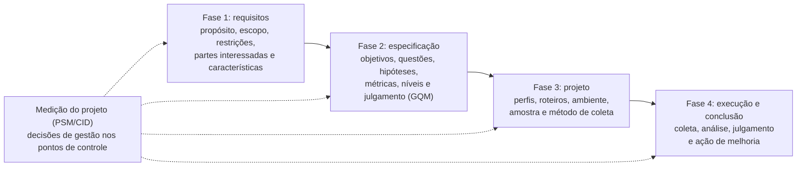

# Metodologia

## Visão geral

O projeto segue as atividades da ISO/IEC 25040, agrupadas em quatro fases. As características priorizadas na Fase 1 originam os objetivos da Fase 2; as métricas da Fase 2 determinam o que é coletado e como na Fase 3; e os dados coletados são analisados e julgados na Fase 4, que termina em ao menos uma ação de melhoria justificada pelas evidências.

*Figura 1: Fluxo da avaliação e acompanhamento do projeto. Fonte: adaptado da Figura 1 do artigo.*

| Fase | Atividade (ISO/IEC 25040) | Principais produtos | Entrega |
| :---: | :--- | :--- | :---: |
| 1 | Estabelecer os requisitos de avaliação | Propósito, escopo, restrições, partes interessadas e características | E1 |
| 2 | Especificar a avaliação | Objetivos, questões, hipóteses, métricas, níveis de pontuação e critérios de julgamento | E1 |
| 3 | Projetar a avaliação | Perfis de passageiro, roteiros, ambiente, amostra, método de coleta e cronograma | E2 |
| 4 | Executar e concluir a avaliação | Coleta, análise, julgamento, melhorias e ação de melhoria | E2 |

*Tabela 1: Fases do projeto. Fonte: elaborado pela equipe.*

Cada entrega inclui o artigo, esta página do projeto (GitPage) e uma release no repositório.

## Organização da equipe e repositório

A equipe de seis integrantes trabalha no [repositório Git da disciplina](https://github.com/FCTE-Qualidade-de-Software-1/2026-2_T01_RUTH_LICHTERMAN), onde ficam os documentos, os dados de coleta e consolidação, as gravações, as atas e os scripts de cálculo. As tarefas são registradas como issues agrupadas em milestones por entrega, e o andamento é acompanhado no [Painel PSM](../gestao/painel.md).

## Rastreabilidade, participantes e proteção de dados

Todo resultado apresentado deve poder ser reconstruído a partir dos dados brutos e dos procedimentos de cálculo versionados no repositório. As sessões com participantes só são gravadas com consentimento registrado. Os participantes são identificados por códigos (P01, P02, ...), e o acesso às gravações e aos dados pessoais é restrito à equipe e à professora, em conformidade com a Lei Geral de Proteção de Dados. Participantes menores de 18 anos só podem ser incluídos com consentimento do responsável.

## Ferramentas utilizadas

| Ferramenta | Uso |
| :--- | :--- |
| GitHub | Versionamento, issues, milestones e GitHub Pages |
| MkDocs Material | Geração deste site |
| LaTeX (Overleaf) | Escrita do artigo |

---

## Histórico de Versões

| Versão | Data | Descrição | Autor(es) | Revisor(es) |
| :----: | :--------: | :--- | :---: | :---: |
| 1.0 | 13/10/2026 | Criação da página | [Arthur Fernandes](https://github.com/arthurfernandesj) | [Giovana Fontes](https://github.com/GiovanaFontesS) |
| 1.1 | 17/10/2026 | Adição de Metodologia Artigo | [Giovana Fontes](https://github.com/GiovanaFontesS) | [Arthur Fernandes](https://github.com/arthurfernandesj) |
| 1.2 | 25/10/2026 | Atualização conforme a Seção III da versão atual do artigo | [Hauedy Wegner](https://github.com/HauedyWS) | [Giovana Fontes](https://github.com/GiovanaFontesS) |
