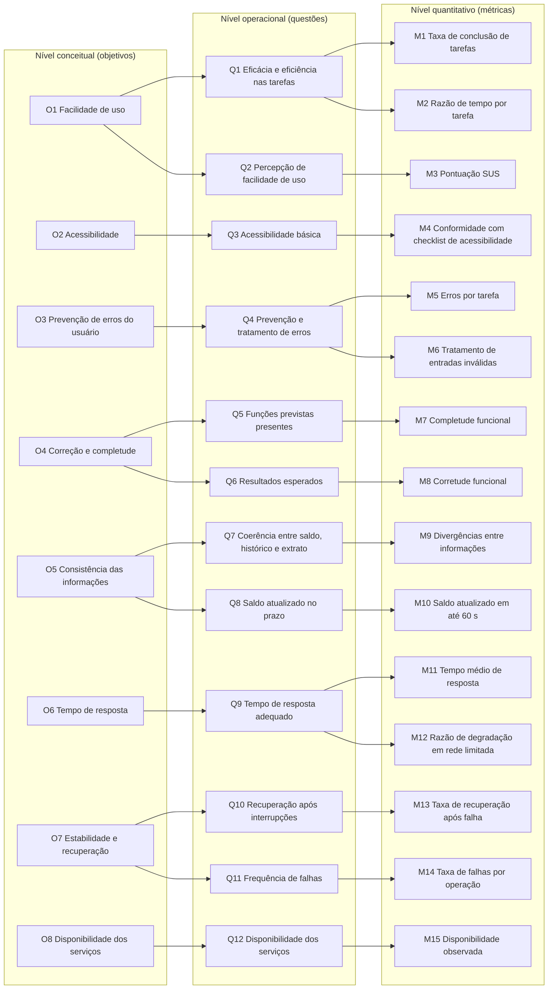

# Gráfico GQM

A Figura 1 mostra a hierarquia completa da avaliação: oito [objetivos](objetivos.md) (nível conceitual), doze [questões](questoes.md) (nível operacional) e quinze [métricas](metricas.md) (nível quantitativo). A Tabela 1, logo abaixo, traz a mesma hierarquia em texto.

*Figura 1: Hierarquia GQM da avaliação do BRB Mobilidade. Fonte: elaborado pela equipe.*

| Característica | Objetivo | Questão | Métricas |
| :--- | :--- | :--- | :--- |
| Usabilidade | O1 Facilidade de uso | Q1 Eficácia e eficiência nas tarefas | M1, M2 |
| Usabilidade | O1 Facilidade de uso | Q2 Percepção de facilidade de uso | M3 |
| Usabilidade | O2 Acessibilidade | Q3 Acessibilidade básica | M4 |
| Usabilidade | O3 Prevenção de erros do usuário | Q4 Prevenção e tratamento de erros | M5, M6 |
| Adequação funcional | O4 Correção e completude | Q5 Funções previstas presentes | M7 |
| Adequação funcional | O4 Correção e completude | Q6 Resultados esperados | M8 |
| Adequação funcional | O5 Consistência das informações | Q7 Coerência entre saldo, histórico e extrato | M9 |
| Adequação funcional | O5 Consistência das informações | Q8 Saldo atualizado no prazo | M10 |
| Eficiência de desempenho | O6 Tempo de resposta | Q9 Tempo de resposta adequado | M11, M12 |
| Confiabilidade | O7 Estabilidade e recuperação | Q10 Recuperação após interrupções | M13 |
| Confiabilidade | O7 Estabilidade e recuperação | Q11 Frequência de falhas | M14 |
| Confiabilidade | O8 Disponibilidade dos serviços | Q12 Disponibilidade dos serviços | M15 |

*Tabela 1: Matriz de rastreabilidade objetivo, questão e métrica. Fonte: elaborado pela equipe.*

---

### Histórico de Versão

| Versão | Data | Descrição | Autor | Revisor |
| :--- | :--- | :--- | :--- | :--- |
| 1.0 | 21/10/2026 | Gráfico GQM completo e matriz de rastreabilidade | [Hauedy Wegner](https://github.com/HauedyWS) | |
