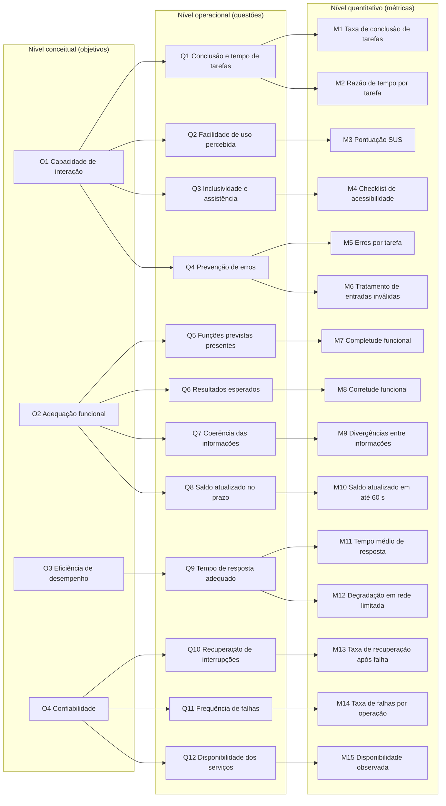

# Gráfico GQM

A Figura 1 mostra a hierarquia completa da avaliação: quatro [objetivos](objetivos.md) (nível conceitual), doze [questões](questoes.md) (nível operacional) e quinze [métricas](metricas.md) (nível quantitativo). A Tabela 1, logo abaixo, traz a mesma hierarquia em texto.

*Figura 1: Hierarquia GQM da avaliação do BRB Mobilidade. Fonte: elaborado pela equipe.*

| Objetivo | Questão | Métricas |
| :--- | :--- | :--- |
| O1 Capacidade de interação | Q1 Conclusão e tempo de tarefas | M1, M2 |
| O1 Capacidade de interação | Q2 Facilidade de uso percebida | M3 |
| O1 Capacidade de interação | Q3 Inclusividade e assistência | M4 |
| O1 Capacidade de interação | Q4 Prevenção de erros | M5, M6 |
| O2 Adequação funcional | Q5 Funções previstas presentes | M7 |
| O2 Adequação funcional | Q6 Resultados esperados | M8 |
| O2 Adequação funcional | Q7 Coerência das informações | M9 |
| O2 Adequação funcional | Q8 Saldo atualizado no prazo | M10 |
| O3 Eficiência de desempenho | Q9 Tempo de resposta adequado | M11, M12 |
| O4 Confiabilidade | Q10 Recuperação de interrupções | M13 |
| O4 Confiabilidade | Q11 Frequência de falhas | M14 |
| O4 Confiabilidade | Q12 Disponibilidade dos serviços | M15 |

*Tabela 1: Matriz de rastreabilidade objetivo, questão e métrica. Fonte: elaborado pela equipe.*

---

### Histórico de Versão

| Versão | Data | Descrição | Autor | Revisor |
| :--- | :--- | :--- | :--- | :--- |
| 1.0 | 21/10/2026 | Gráfico GQM completo e matriz de rastreabilidade | [Hauedy Wegner](https://github.com/HauedyWS) | |
| 2.0 | 25/10/2026 | Gráfico com quatro objetivos, conforme a Figura 2 da versão atual do artigo | [Hauedy Wegner](https://github.com/HauedyWS) | |
