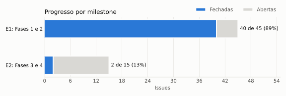
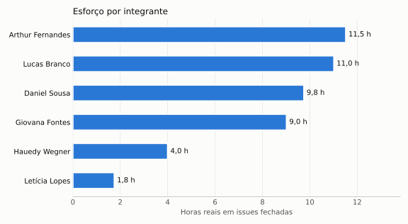

# Painel PSM/CID

Esta página é gerada automaticamente pelo script [`scripts/coleta_psm.py`](https://github.com/FCTE-Qualidade-de-Software-1/2026-2_T01_RUTH_LICHTERMAN/blob/main/scripts/coleta_psm.py) a partir das issues, eventos e commits do [repositório da equipe](https://github.com/FCTE-Qualidade-de-Software-1/2026-2_T01_RUTH_LICHTERMAN). Ela é atualizada a cada publicação do site. A definição dos indicadores, os limites e o registro das decisões de gestão estão em [Gestão do projeto com PSM/CID](psm.md).

**Última coleta:** 26/10/2026 às 00:48 (horário de Brasília). **Issues analisadas:** 56.

## Indicadores

| ID | Categoria | Indicador | Valor atual | Situação | Limite de alerta |
|---|---|---|---|---|---|
| CP-1 | Calendário e Progresso | Planejado vs. concluído (E1: Fases 1 e 2) | 30/43 concluídas (69,8%); esperado 86,8%; desvio 17,0 p.p. | Ação corretiva | Desvio acima de 5 p.p.: investigar; acima de 10 p.p.: ação corretiva |
| RC-1 | Recursos e Custos | Estimado vs. realizado (horas reais / estimadas) | 1,12 (45,5 h / 40,8 h, 31 issues) | Dentro do esperado | Fora da faixa 0,8 a 1,2 |
| RC-2 | Recursos e Custos | Esforço por integrante (% das horas reais) | Arthur 19%, Daniel 21%, Giovana 23%, Hauedy 8%, Letícia 5%, Lucas 24% | Alerta: Hauedy Wegner, Letícia Maria | Integrante abaixo de 10% ou acima de 30% |
| DP-1 | Desempenho dos Processos | Tempo de ciclo (atribuição até fechamento) | média 2,0 dias (22 issues) | Investigar 7 issues a mais de 10% da média; Alerta: 5 issues com responsável há mais de 3 dias | Issue a mais de 10% da média (mínimo 1 dia): investigar; aberta com responsável há mais de 3 dias: cobrar ou dividir |

*Tabela 1: Valores atuais dos indicadores PSM/CID. Fonte: [indicadores.csv](dados/indicadores.csv), gerado pelo script de coleta.*

## Calendário e Progresso

*Figura 1: Progresso das issues por milestone. Fonte: issues do GitHub.*

| Milestone | Prazo | Issues | Fechadas | Abertas | Concluído | Esperado | Desvio | Situação |
|---|---|---|---|---|---|---|---|---|
| E1: Fases 1 e 2 | 26/10/2026 | 43 | 30 | 13 | 69,8% | 86,8% | 17,0 p.p. | Ação corretiva |
| E2: Fases 3 e 4 | - | 13 | 1 | 12 | 7,7% | - | - | Sem prazo definido |

*Tabela 2: Planejado vs. concluído por milestone. Esperado = fração do prazo do milestone já decorrida; desvio = esperado - concluído. Fonte: issues do GitHub.*

## Recursos e Custos: contribuição por integrante

*Figura 2: Esforço por integrante, medido em horas reais registradas nas issues fechadas. Fonte: issues do GitHub.*

| Integrante | Issues atribuídas | Fechadas | Abertas | Horas estimadas | Horas reais | % das horas reais | % das issues fechadas | Commits |
|---|---|---|---|---|---|---|---|---|
| Arthur Fernandes | 14 | 10 | 4 | 13,6 | 8,5 | 18,7% | 22,7% | 5 |
| Daniel Sousa | 12 | 8 | 4 | 15,8 | 9,8 | 21,4% | 18,2% | 2 |
| Giovana Fontes | 14 | 10 | 4 | 15,6 | 10,5 | 23,1% | 22,7% | 4 |
| Hauedy Wegner | 9 | 4 | 5 | 12,5 | 3,5 | 7,7% | 9,1% | 8 |
| Letícia Maria | 11 | 4 | 7 | 12,8 | 2,2 | 4,9% | 9,1% | 6 |
| Lucas Branco | 11 | 8 | 3 | 17,1 | 11,0 | 24,2% | 18,2% | 0 |

*Tabela 3: Contribuição por integrante. Quando uma issue tem mais de um responsável, as horas são divididas igualmente. Fonte: [contribuicao.csv](dados/contribuicao.csv).*

## Desempenho dos Processos: tempo de ciclo

Média: **2,0 dias** em 22 issues. Faixa sem investigação: 1,0 a 3,0 dias (média ± o maior valor entre 10% da média e 1 dia).

| Issue | Responsável | Atribuída em | Fechada em | Tempo de ciclo (dias) | Situação |
|---|---|---|---|---|---|
| [#31](https://github.com/FCTE-Qualidade-de-Software-1/2026-2_T01_RUTH_LICHTERMAN/issues/31) GitPage: remover emojis e ícones | Letícia Maria | 20/10/2026 | 20/10/2026 | 1 | Investigar |
| [#57](https://github.com/FCTE-Qualidade-de-Software-1/2026-2_T01_RUTH_LICHTERMAN/issues/57) Padronizar nomenclatura da ISO/IEC 25010 (2011 x 2023) no artigo e no GitPage | Arthur Fernandes, Hauedy Wegner | 21/10/2026 | 23/10/2026 | 3 | Dentro da faixa |
| [#20](https://github.com/FCTE-Qualidade-de-Software-1/2026-2_T01_RUTH_LICHTERMAN/issues/20) Fase 2: métricas com definição, cálculo, fonte, coleta e interpretação | Arthur Fernandes, Giovana Fontes | 21/10/2026 | 23/10/2026 | 3 | Dentro da faixa |
| [#15](https://github.com/FCTE-Qualidade-de-Software-1/2026-2_T01_RUTH_LICHTERMAN/issues/15) Fase 1: escopo, profundidade e objetos de avaliação | Arthur Fernandes, Giovana Fontes | 23/10/2026 | 23/10/2026 | 1 | Investigar |
| [#50](https://github.com/FCTE-Qualidade-de-Software-1/2026-2_T01_RUTH_LICHTERMAN/issues/50) Fase 4: análise e respostas às questões GQM | Lucas Branco | 23/10/2026 | 23/10/2026 | 1 | Investigar |
| [#25](https://github.com/FCTE-Qualidade-de-Software-1/2026-2_T01_RUTH_LICHTERMAN/issues/25) Artigo: referencial teórico | Arthur Fernandes, Giovana Fontes, Lucas Branco | 23/10/2026 | 23/10/2026 | 1 | Investigar |
| [#11](https://github.com/FCTE-Qualidade-de-Software-1/2026-2_T01_RUTH_LICHTERMAN/issues/11) Fase 1: requisitante e partes interessadas | Daniel Sousa | 25/10/2026 | 25/10/2026 | 1 | Investigar |
| [#10](https://github.com/FCTE-Qualidade-de-Software-1/2026-2_T01_RUTH_LICHTERMAN/issues/10) Fase 1: propósito da avaliação, decisões apoiadas e quem as toma | Giovana Fontes | 23/10/2026 | 26/10/2026 | 4 | Investigar |
| [#17](https://github.com/FCTE-Qualidade-de-Software-1/2026-2_T01_RUTH_LICHTERMAN/issues/17) Fase 2: objetivos de medição no template GQM | Daniel Sousa | 25/10/2026 | 26/10/2026 | 2 | Dentro da faixa |
| [#18](https://github.com/FCTE-Qualidade-de-Software-1/2026-2_T01_RUTH_LICHTERMAN/issues/18) Fase 2: questões de avaliação | Daniel Sousa | 25/10/2026 | 26/10/2026 | 2 | Dentro da faixa |
| [#19](https://github.com/FCTE-Qualidade-de-Software-1/2026-2_T01_RUTH_LICHTERMAN/issues/19) Fase 2: hipóteses para todas as questões | Daniel Sousa | 25/10/2026 | 26/10/2026 | 2 | Dentro da faixa |
| [#21](https://github.com/FCTE-Qualidade-de-Software-1/2026-2_T01_RUTH_LICHTERMAN/issues/21) Fase 2: níveis de pontuação e critérios de julgamento | Daniel Sousa | 25/10/2026 | 26/10/2026 | 2 | Dentro da faixa |
| [#22](https://github.com/FCTE-Qualidade-de-Software-1/2026-2_T01_RUTH_LICHTERMAN/issues/22) Fase 2: diagrama GQM completo | Daniel Sousa, Giovana Fontes | 25/10/2026 | 26/10/2026 | 2 | Dentro da faixa |
| [#23](https://github.com/FCTE-Qualidade-de-Software-1/2026-2_T01_RUTH_LICHTERMAN/issues/23) Fase 2: consistência entre as Fases 1 e 2 | Daniel Sousa | 25/10/2026 | 26/10/2026 | 2 | Dentro da faixa |
| [#24](https://github.com/FCTE-Qualidade-de-Software-1/2026-2_T01_RUTH_LICHTERMAN/issues/24) Artigo: migrar para template SBC/ACM/IEEE em LaTeX | Giovana Fontes | 25/10/2026 | 26/10/2026 | 2 | Dentro da faixa |
| [#26](https://github.com/FCTE-Qualidade-de-Software-1/2026-2_T01_RUTH_LICHTERMAN/issues/26) Artigo: seções da Fase 1 e da Fase 2 | Lucas Branco | 23/10/2026 | 26/10/2026 | 4 | Investigar |
| [#34](https://github.com/FCTE-Qualidade-de-Software-1/2026-2_T01_RUTH_LICHTERMAN/issues/34) Página de referências | Lucas Branco | 25/10/2026 | 26/10/2026 | 2 | Dentro da faixa |
| [#29](https://github.com/FCTE-Qualidade-de-Software-1/2026-2_T01_RUTH_LICHTERMAN/issues/29) GitPage: versão e data no rodapé, sumário e links entre páginas | Letícia Maria | 25/10/2026 | 26/10/2026 | 2 | Dentro da faixa |
| [#30](https://github.com/FCTE-Qualidade-de-Software-1/2026-2_T01_RUTH_LICHTERMAN/issues/30) GitPage: links para repositório, release e evidências | Letícia Maria | 25/10/2026 | 26/10/2026 | 2 | Dentro da faixa |
| [#33](https://github.com/FCTE-Qualidade-de-Software-1/2026-2_T01_RUTH_LICHTERMAN/issues/33) Página de uso de IA | Letícia Maria | 25/10/2026 | 26/10/2026 | 2 | Dentro da faixa |
| [#35](https://github.com/FCTE-Qualidade-de-Software-1/2026-2_T01_RUTH_LICHTERMAN/issues/35) README enxuto e remoção do .venv do repositório | Hauedy Wegner | 25/10/2026 | 26/10/2026 | 2 | Dentro da faixa |
| [#36](https://github.com/FCTE-Qualidade-de-Software-1/2026-2_T01_RUTH_LICHTERMAN/issues/36) Template de issue e milestones | Hauedy Wegner | 25/10/2026 | 26/10/2026 | 2 | Dentro da faixa |

*Tabela 4: Tempo de ciclo das issues concluídas, de (data de fechamento - data da primeira atribuição) + 1, como no PSM/CID Parte 2, seção 8.5. Issues retroativas ficam de fora. Fonte: issues e eventos do GitHub.*

**Issues com responsável há mais de 3 dias sem fechar:** [#28](https://github.com/FCTE-Qualidade-de-Software-1/2026-2_T01_RUTH_LICHTERMAN/issues/28) (4 dias), [#48](https://github.com/FCTE-Qualidade-de-Software-1/2026-2_T01_RUTH_LICHTERMAN/issues/48) (4 dias), [#49](https://github.com/FCTE-Qualidade-de-Software-1/2026-2_T01_RUTH_LICHTERMAN/issues/49) (4 dias), [#51](https://github.com/FCTE-Qualidade-de-Software-1/2026-2_T01_RUTH_LICHTERMAN/issues/51) (4 dias), [#52](https://github.com/FCTE-Qualidade-de-Software-1/2026-2_T01_RUTH_LICHTERMAN/issues/52) (4 dias)

## Quem fez o quê

### Issues concluídas

| Issue | Responsável | Milestone | Horas reais | Concluída em |
|---|---|---|---|---|
| [#1](https://github.com/FCTE-Qualidade-de-Software-1/2026-2_T01_RUTH_LICHTERMAN/issues/1) Estrutura inicial do GitPage (MkDocs) | Arthur Fernandes | E1: Fases 1 e 2 | 1,0 | 19/10/2026 |
| [#2](https://github.com/FCTE-Qualidade-de-Software-1/2026-2_T01_RUTH_LICHTERMAN/issues/2) Publicação automática no GitHub Pages | Hauedy Wegner | E1: Fases 1 e 2 | 0,5 | 19/10/2026 |
| [#3](https://github.com/FCTE-Qualidade-de-Software-1/2026-2_T01_RUTH_LICHTERMAN/issues/3) Fase 1: apresentação do software | Arthur Fernandes | E1: Fases 1 e 2 | 0,5 | 19/10/2026 |
| [#4](https://github.com/FCTE-Qualidade-de-Software-1/2026-2_T01_RUTH_LICHTERMAN/issues/4) Fase 1: levantamento de funcionalidades e serviços | Lucas Branco | E1: Fases 1 e 2 | 1,0 | 19/10/2026 |
| [#5](https://github.com/FCTE-Qualidade-de-Software-1/2026-2_T01_RUTH_LICHTERMAN/issues/5) Fase 1: requisitos e necessidades dos usuários | Lucas Branco | E1: Fases 1 e 2 | 1,0 | 19/10/2026 |
| [#6](https://github.com/FCTE-Qualidade-de-Software-1/2026-2_T01_RUTH_LICHTERMAN/issues/6) Fase 1: tecnologias e integração | Arthur Fernandes, Giovana Fontes | E1: Fases 1 e 2 | 0,5 | 19/10/2026 |
| [#7](https://github.com/FCTE-Qualidade-de-Software-1/2026-2_T01_RUTH_LICHTERMAN/issues/7) Artigo: introdução | Arthur Fernandes, Giovana Fontes, Lucas Branco | E1: Fases 1 e 2 | 2,0 | 19/10/2026 |
| [#8](https://github.com/FCTE-Qualidade-de-Software-1/2026-2_T01_RUTH_LICHTERMAN/issues/8) Artigo: metodologia | Arthur Fernandes, Giovana Fontes | E1: Fases 1 e 2 | 2,0 | 19/10/2026 |
| [#9](https://github.com/FCTE-Qualidade-de-Software-1/2026-2_T01_RUTH_LICHTERMAN/issues/9) Slides do Ponto de Controle 1 | Arthur Fernandes, Daniel Sousa, Giovana Fontes, Lucas Branco | E1: Fases 1 e 2 | 5,0 | 19/10/2026 |
| [#31](https://github.com/FCTE-Qualidade-de-Software-1/2026-2_T01_RUTH_LICHTERMAN/issues/31) GitPage: remover emojis e ícones | Letícia Maria | E1: Fases 1 e 2 | 0,2 | 20/10/2026 |
| [#57](https://github.com/FCTE-Qualidade-de-Software-1/2026-2_T01_RUTH_LICHTERMAN/issues/57) Padronizar nomenclatura da ISO/IEC 25010 (2011 x 2023) no artigo e no GitPage | Arthur Fernandes, Hauedy Wegner | E1: Fases 1 e 2 | 3,0 | 23/10/2026 |
| [#20](https://github.com/FCTE-Qualidade-de-Software-1/2026-2_T01_RUTH_LICHTERMAN/issues/20) Fase 2: métricas com definição, cálculo, fonte, coleta e interpretação | Arthur Fernandes, Giovana Fontes | E1: Fases 1 e 2 | 4,0 | 23/10/2026 |
| [#15](https://github.com/FCTE-Qualidade-de-Software-1/2026-2_T01_RUTH_LICHTERMAN/issues/15) Fase 1: escopo, profundidade e objetos de avaliação | Arthur Fernandes, Giovana Fontes | E1: Fases 1 e 2 | 0,5 | 23/10/2026 |
| [#50](https://github.com/FCTE-Qualidade-de-Software-1/2026-2_T01_RUTH_LICHTERMAN/issues/50) Fase 4: análise e respostas às questões GQM | Lucas Branco | E2: Fases 3 e 4 | 2,0 | 23/10/2026 |
| [#25](https://github.com/FCTE-Qualidade-de-Software-1/2026-2_T01_RUTH_LICHTERMAN/issues/25) Artigo: referencial teórico | Arthur Fernandes, Giovana Fontes, Lucas Branco | E1: Fases 1 e 2 | 0,3 | 23/10/2026 |
| [#11](https://github.com/FCTE-Qualidade-de-Software-1/2026-2_T01_RUTH_LICHTERMAN/issues/11) Fase 1: requisitante e partes interessadas | Daniel Sousa | E1: Fases 1 e 2 | 1,0 | 25/10/2026 |
| [#10](https://github.com/FCTE-Qualidade-de-Software-1/2026-2_T01_RUTH_LICHTERMAN/issues/10) Fase 1: propósito da avaliação, decisões apoiadas e quem as toma | Giovana Fontes | E1: Fases 1 e 2 | 1,5 | 26/10/2026 |
| [#17](https://github.com/FCTE-Qualidade-de-Software-1/2026-2_T01_RUTH_LICHTERMAN/issues/17) Fase 2: objetivos de medição no template GQM | Daniel Sousa | E1: Fases 1 e 2 | 1,5 | 26/10/2026 |
| [#18](https://github.com/FCTE-Qualidade-de-Software-1/2026-2_T01_RUTH_LICHTERMAN/issues/18) Fase 2: questões de avaliação | Daniel Sousa | E1: Fases 1 e 2 | 1,5 | 26/10/2026 |
| [#19](https://github.com/FCTE-Qualidade-de-Software-1/2026-2_T01_RUTH_LICHTERMAN/issues/19) Fase 2: hipóteses para todas as questões | Daniel Sousa | E1: Fases 1 e 2 | 1,0 | 26/10/2026 |
| [#21](https://github.com/FCTE-Qualidade-de-Software-1/2026-2_T01_RUTH_LICHTERMAN/issues/21) Fase 2: níveis de pontuação e critérios de julgamento | Daniel Sousa | E1: Fases 1 e 2 | 2,0 | 26/10/2026 |
| [#22](https://github.com/FCTE-Qualidade-de-Software-1/2026-2_T01_RUTH_LICHTERMAN/issues/22) Fase 2: diagrama GQM completo | Daniel Sousa, Giovana Fontes | E1: Fases 1 e 2 | 1,0 | 26/10/2026 |
| [#23](https://github.com/FCTE-Qualidade-de-Software-1/2026-2_T01_RUTH_LICHTERMAN/issues/23) Fase 2: consistência entre as Fases 1 e 2 | Daniel Sousa | E1: Fases 1 e 2 | 1,0 | 26/10/2026 |
| [#24](https://github.com/FCTE-Qualidade-de-Software-1/2026-2_T01_RUTH_LICHTERMAN/issues/24) Artigo: migrar para template SBC/ACM/IEEE em LaTeX | Giovana Fontes | E1: Fases 1 e 2 | 3,0 | 26/10/2026 |
| [#26](https://github.com/FCTE-Qualidade-de-Software-1/2026-2_T01_RUTH_LICHTERMAN/issues/26) Artigo: seções da Fase 1 e da Fase 2 | Lucas Branco | E1: Fases 1 e 2 | 4,0 | 26/10/2026 |
| [#34](https://github.com/FCTE-Qualidade-de-Software-1/2026-2_T01_RUTH_LICHTERMAN/issues/34) Página de referências | Lucas Branco | E1: Fases 1 e 2 | 1,0 | 26/10/2026 |
| [#29](https://github.com/FCTE-Qualidade-de-Software-1/2026-2_T01_RUTH_LICHTERMAN/issues/29) GitPage: versão e data no rodapé, sumário e links entre páginas | Letícia Maria | E1: Fases 1 e 2 | 1,0 | 26/10/2026 |
| [#30](https://github.com/FCTE-Qualidade-de-Software-1/2026-2_T01_RUTH_LICHTERMAN/issues/30) GitPage: links para repositório, release e evidências | Letícia Maria | E1: Fases 1 e 2 | 0,5 | 26/10/2026 |
| [#33](https://github.com/FCTE-Qualidade-de-Software-1/2026-2_T01_RUTH_LICHTERMAN/issues/33) Página de uso de IA | Letícia Maria | E1: Fases 1 e 2 | 0,5 | 26/10/2026 |
| [#35](https://github.com/FCTE-Qualidade-de-Software-1/2026-2_T01_RUTH_LICHTERMAN/issues/35) README enxuto e remoção do .venv do repositório | Hauedy Wegner | E1: Fases 1 e 2 | 0,5 | 26/10/2026 |
| [#36](https://github.com/FCTE-Qualidade-de-Software-1/2026-2_T01_RUTH_LICHTERMAN/issues/36) Template de issue e milestones | Hauedy Wegner | E1: Fases 1 e 2 | 1,0 | 26/10/2026 |

### Issues em andamento

| Issue | Responsável | Milestone | Horas estimadas |
|---|---|---|---|
| [#12](https://github.com/FCTE-Qualidade-de-Software-1/2026-2_T01_RUTH_LICHTERMAN/issues/12) Fase 1: tipo de produto e descrição estruturada com diagrama de contexto | Arthur Fernandes | E1: Fases 1 e 2 | 2,0 |
| [#13](https://github.com/FCTE-Qualidade-de-Software-1/2026-2_T01_RUTH_LICHTERMAN/issues/13) Fase 1: modelo de qualidade adaptado com diagrama | Giovana Fontes | E1: Fases 1 e 2 | 2,0 |
| [#14](https://github.com/FCTE-Qualidade-de-Software-1/2026-2_T01_RUTH_LICHTERMAN/issues/14) Fase 1: seleção e priorização de 3 a 4 características (sem usabilidade) | Daniel Sousa | E1: Fases 1 e 2 | 1,5 |
| [#16](https://github.com/FCTE-Qualidade-de-Software-1/2026-2_T01_RUTH_LICHTERMAN/issues/16) Fase 1: ODS, metas e indicadores | Daniel Sousa | E1: Fases 1 e 2 | 1,0 |
| [#27](https://github.com/FCTE-Qualidade-de-Software-1/2026-2_T01_RUTH_LICHTERMAN/issues/27) Artigo: link do repositório e tabela de contribuição no apêndice | Giovana Fontes | E1: Fases 1 e 2 | 1,0 |
| [#28](https://github.com/FCTE-Qualidade-de-Software-1/2026-2_T01_RUTH_LICHTERMAN/issues/28) Artigo: revisão final da E1 | Giovana Fontes | E1: Fases 1 e 2 | 2,0 |
| [#32](https://github.com/FCTE-Qualidade-de-Software-1/2026-2_T01_RUTH_LICHTERMAN/issues/32) GitPage: texto alternativo em todas as imagens | Letícia Maria | E1: Fases 1 e 2 | 0,5 |
| [#37](https://github.com/FCTE-Qualidade-de-Software-1/2026-2_T01_RUTH_LICHTERMAN/issues/37) Release E1 | Hauedy Wegner | E1: Fases 1 e 2 | 0,5 |
| [#38](https://github.com/FCTE-Qualidade-de-Software-1/2026-2_T01_RUTH_LICHTERMAN/issues/38) Página PSM/CID com as três categorias | Hauedy Wegner | E1: Fases 1 e 2 | 3,0 |
| [#39](https://github.com/FCTE-Qualidade-de-Software-1/2026-2_T01_RUTH_LICHTERMAN/issues/39) Medição PSM nº 1 | Letícia Maria | E1: Fases 1 e 2 | 1,0 |
| [#40](https://github.com/FCTE-Qualidade-de-Software-1/2026-2_T01_RUTH_LICHTERMAN/issues/40) Medição PSM nº 2 | Hauedy Wegner | E1: Fases 1 e 2 | 1,0 |
| [#41](https://github.com/FCTE-Qualidade-de-Software-1/2026-2_T01_RUTH_LICHTERMAN/issues/41) Tabela de contribuição com percentual de esforço | Letícia Maria | E1: Fases 1 e 2 | 1,5 |
| [#42](https://github.com/FCTE-Qualidade-de-Software-1/2026-2_T01_RUTH_LICHTERMAN/issues/42) Atas das reuniões | Letícia Maria | E1: Fases 1 e 2 | 2,0 |
| [#43](https://github.com/FCTE-Qualidade-de-Software-1/2026-2_T01_RUTH_LICHTERMAN/issues/43) Correções do Ponto de Controle 1 | Hauedy Wegner | E2: Fases 3 e 4 | 1,5 |
| [#44](https://github.com/FCTE-Qualidade-de-Software-1/2026-2_T01_RUTH_LICHTERMAN/issues/44) Fase 3: método de avaliação e instruções repetíveis | Arthur Fernandes | E2: Fases 3 e 4 | 3,0 |
| [#45](https://github.com/FCTE-Qualidade-de-Software-1/2026-2_T01_RUTH_LICHTERMAN/issues/45) Fase 3: recursos, ambiente e massa de dados | Daniel Sousa | E2: Fases 3 e 4 | 1,5 |
| [#46](https://github.com/FCTE-Qualidade-de-Software-1/2026-2_T01_RUTH_LICHTERMAN/issues/46) Fase 3: cronograma da avaliação | Arthur Fernandes | E2: Fases 3 e 4 | 1,0 |
| [#47](https://github.com/FCTE-Qualidade-de-Software-1/2026-2_T01_RUTH_LICHTERMAN/issues/47) Termo de consentimento dos participantes | Arthur Fernandes | E2: Fases 3 e 4 | 1,5 |
| [#48](https://github.com/FCTE-Qualidade-de-Software-1/2026-2_T01_RUTH_LICHTERMAN/issues/48) Fase 4: coleta das medidas com evidências | Lucas Branco | E2: Fases 3 e 4 | 3,0 |
| [#49](https://github.com/FCTE-Qualidade-de-Software-1/2026-2_T01_RUTH_LICHTERMAN/issues/49) Fase 4: dados brutos organizados e rastreáveis | Letícia Maria | E2: Fases 3 e 4 | 2,0 |
| [#51](https://github.com/FCTE-Qualidade-de-Software-1/2026-2_T01_RUTH_LICHTERMAN/issues/51) Fase 4: julgamento, conclusões e coerência com o propósito | Lucas Branco | E2: Fases 3 e 4 | 2,0 |
| [#52](https://github.com/FCTE-Qualidade-de-Software-1/2026-2_T01_RUTH_LICHTERMAN/issues/52) Discussão das relações entre as características | Lucas Branco | E2: Fases 3 e 4 | 1,5 |
| [#53](https://github.com/FCTE-Qualidade-de-Software-1/2026-2_T01_RUTH_LICHTERMAN/issues/53) Ação de melhoria obrigatória | Hauedy Wegner, Letícia Maria | E2: Fases 3 e 4 | 6,0 |
| [#54](https://github.com/FCTE-Qualidade-de-Software-1/2026-2_T01_RUTH_LICHTERMAN/issues/54) Artigo: versão final | Daniel Sousa, Giovana Fontes | E2: Fases 3 e 4 | 4,0 |
| [#55](https://github.com/FCTE-Qualidade-de-Software-1/2026-2_T01_RUTH_LICHTERMAN/issues/55) Release E2 | Letícia Maria | E2: Fases 3 e 4 | 0,5 |

## Histórico de medições registradas

| Data | ID | Indicador | Valor | Situação |
|---|---|---|---|---|
| 26/10/2026 00:10 | CP-1 | Planejado vs. concluído (E1: Fases 1 e 2) | 15/43 concluídas (34,9%); esperado 86,4%; desvio 51,5 p.p. | Ação corretiva |
| 26/10/2026 00:10 | RC-1 | Estimado vs. realizado (horas reais / estimadas) | 1,24 (24,6 h / 19,8 h, 16 issues) | Alerta |
| 26/10/2026 00:10 | RC-2 | Esforço por integrante (% das horas reais) | Arthur 35%, Daniel 9%, Giovana 22%, Hauedy 8%, Letícia 1%, Lucas 25% | Alerta: Arthur Fernandes, Daniel Sousa, Hauedy Wegner, Letícia Maria |
| 26/10/2026 00:10 | DP-1 | Tempo de ciclo (atribuição até fechamento) | média 1,6 dias (7 issues) | Investigar 2 issues a mais de 10% da média; Alerta: 7 issues com responsável há mais de 3 dias |
| 26/10/2026 00:48 | CP-1 | Planejado vs. concluído (E1: Fases 1 e 2) | 30/43 concluídas (69,8%); esperado 86,8%; desvio 17,0 p.p. | Ação corretiva |
| 26/10/2026 00:48 | RC-1 | Estimado vs. realizado (horas reais / estimadas) | 1,12 (45,5 h / 40,8 h, 31 issues) | Dentro do esperado |
| 26/10/2026 00:48 | RC-2 | Esforço por integrante (% das horas reais) | Arthur 19%, Daniel 21%, Giovana 23%, Hauedy 8%, Letícia 5%, Lucas 24% | Alerta: Hauedy Wegner, Letícia Maria |
| 26/10/2026 00:48 | DP-1 | Tempo de ciclo (atribuição até fechamento) | média 2,0 dias (22 issues) | Investigar 7 issues a mais de 10% da média; Alerta: 5 issues com responsável há mais de 3 dias |

*Tabela 5: Medições registradas com `python scripts/coleta_psm.py --registrar`. Fonte: [medicoes.csv](dados/medicoes.csv). A interpretação e a decisão de cada medição ficam na [Tabela 8 da página PSM/CID](psm.md#registro-de-medicoes-e-decisoes).*

## Dados brutos

- [issues.csv](dados/issues.csv): todas as issues com responsáveis, datas e horas.
- [contribuicao.csv](dados/contribuicao.csv): totais por integrante.
- [indicadores.csv](dados/indicadores.csv): valores atuais dos indicadores.
- [medicoes.csv](dados/medicoes.csv): histórico de medições registradas.
