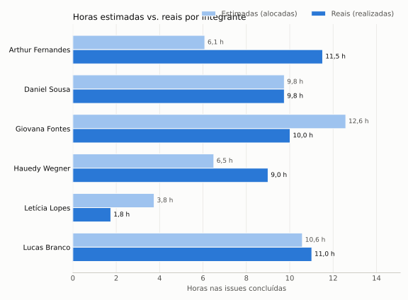

# Painel PSM/CID

Esta página é gerada automaticamente pelo script [`scripts/coleta_psm.py`](https://github.com/FCTE-Qualidade-de-Software-1/2026-2_T01_RUTH_LICHTERMAN/blob/main/scripts/coleta_psm.py) a partir das issues, eventos e commits do [repositório da equipe](https://github.com/FCTE-Qualidade-de-Software-1/2026-2_T01_RUTH_LICHTERMAN). Ela é atualizada a cada publicação do site. A definição dos indicadores, os limites e o registro das decisões de gestão estão em [Gestão do projeto com PSM/CID](psm.md).

**Última coleta:** 26/10/2026 às 16:26 (horário de Brasília). **Issues analisadas:** 58.

## Indicadores

CP-1 · Planejado vs. concluído<strong>79,1%</strong><em class="flat">concluído em E1: Fases 1 e 2 · esperado 95,7% · desvio 16,6 p.p.</em>Ação corretiva

RC-1 · Estimado vs. real<strong>1,08</strong><em class="flat">53,0 h reais ÷ 49,2 h estimadas</em>Dentro do esperado

RC-2 · Esforço por integrante<strong>3% a 22%</strong><em class="flat">menor e maior participação nas horas reais</em>Alerta: Letícia Lopes

DP-1 · Tempo de ciclo<strong>2,1 dias</strong><em class="flat">média em 26 issues · 0 paradas</em>Investigar 8 issues a mais de 10% da média

??? info "Valores e limites de todos os indicadores (tabela)"
    | ID | Categoria | Indicador | Valor atual | Situação | Limite de alerta |
    |---|---|---|---|---|---|
    | CP-1 | Calendário e Progresso | Planejado vs. concluído (E1: Fases 1 e 2) | 34/43 concluídas (79,1%); esperado 95,7%; desvio 16,6 p.p. | Ação corretiva | Desvio acima de 5 p.p.: investigar; acima de 10 p.p.: ação corretiva |
    | RC-1 | Recursos e Custos | Estimado vs. realizado (horas reais / estimadas) | 1,08 (53,0 h / 49,2 h, 35 issues) | Dentro do esperado | Fora da faixa 0,8 a 1,2 |
    | RC-2 | Recursos e Custos | Esforço por integrante (% das horas reais) | Arthur 22%, Daniel 18%, Giovana 19%, Hauedy 17%, Letícia 3%, Lucas 21% | Alerta: Letícia Lopes | Integrante abaixo de 10% ou acima de 30% |
    | DP-1 | Desempenho dos Processos | Tempo de ciclo (atribuição até fechamento) | média 2,1 dias (26 issues) | Investigar 8 issues a mais de 10% da média | Issue a mais de 10% da média (mínimo 1 dia): investigar; aberta com responsável há mais de 3 dias: cobrar ou dividir |

    *Tabela 1: Valores atuais dos indicadores PSM/CID. Fonte: [indicadores.csv](dados/indicadores.csv).*

## Calendário e Progresso

*Figura 1: Progresso das issues por milestone. Fonte: issues do GitHub.*

| Milestone | Prazo | Issues | Fechadas | Abertas | Concluído | Esperado | Desvio | Situação |
|---|---|---|---|---|---|---|---|---|
| E1: Fases 1 e 2 | 26/10/2026 | 43 | 34 | 9 | 79,1% | 95,7% | 16,6 p.p. | Ação corretiva |
| E2: Fases 3 e 4 | - | 15 | 1 | 14 | 6,7% | - | - | Sem prazo definido |

*Tabela 2: Planejado vs. concluído por milestone. Esperado = fração do prazo do milestone já decorrida; desvio = esperado - concluído. Fonte: issues do GitHub.*

## Recursos e Custos: contribuição por integrante

*Figura 2: Esforço por integrante, medido em horas reais registradas nas issues fechadas. Fonte: issues do GitHub.*

| Integrante | Issues atribuídas | Fechadas | Abertas | Horas estimadas | Horas reais | % das horas reais | % das issues fechadas | Commits |
|---|---|---|---|---|---|---|---|---|
| Arthur Fernandes | 16 | 10 | 6 | 19,1 | 11,5 | 21,7% | 20,8% | 5 |
| Daniel Sousa | 12 | 8 | 4 | 17,2 | 9,8 | 18,4% | 16,7% | 2 |
| Giovana Fontes | 15 | 12 | 3 | 20,6 | 10,0 | 18,9% | 25,0% | 6 |
| Hauedy Wegner | 10 | 5 | 5 | 18,0 | 9,0 | 17,0% | 10,4% | 12 |
| Letícia Lopes | 10 | 5 | 5 | 10,8 | 1,8 | 3,3% | 10,4% | 6 |
| Lucas Branco | 10 | 8 | 2 | 15,1 | 11,0 | 20,8% | 16,7% | 1 |

*Tabela 3: Contribuição por integrante. Horas estimadas ficam com quem foi alocado; horas reais, com quem realizou a tarefa. Quando há mais de uma pessoa, as horas são divididas igualmente. Fonte: [contribuicao.csv](dados/contribuicao.csv).*

## Recursos e Custos: horas estimadas vs. reais

Paralelo entre o esforço planejado e o realizado (medida *Estimate vs. Actual Effort* do PSM/CID). O planejado é a soma das horas estimadas das tarefas concluídas que cada pessoa recebeu; o realizado é a soma das horas reais das tarefas que cada pessoa de fato executou.

*Figura 3: Horas estimadas (alocadas) e horas reais (realizadas) por integrante, nas issues concluídas. Fonte: issues do GitHub e execucao.csv.*

| Integrante | Horas estimadas (alocadas) | Horas reais (realizadas) | Diferença |
|---|---|---|---|
| Arthur Fernandes | 6,1 | 11,5 | 5,4 |
| Daniel Sousa | 9,8 | 9,8 | 0,0 |
| Giovana Fontes | 12,6 | 10,0 | -2,6 |
| Hauedy Wegner | 6,5 | 9,0 | 2,5 |
| Letícia Lopes | 3,8 | 1,8 | -2,0 |
| Lucas Branco | 10,6 | 11,0 | 0,4 |

*Tabela 4: Horas estimadas vs. reais por integrante. Diferença positiva: a pessoa trabalhou mais do que o alocado; negativa: menos. Fonte: issues do GitHub.*

??? note "Estimado vs. real por issue"
    | Issue | Estimado (h) | Real (h) | Real ÷ estimado |
    |---|---|---|---|
    | [#1](https://github.com/FCTE-Qualidade-de-Software-1/2026-2_T01_RUTH_LICHTERMAN/issues/1) Estrutura inicial do GitPage (MkDocs) | 1,0 | 1,0 | 1,00 |
    | [#2](https://github.com/FCTE-Qualidade-de-Software-1/2026-2_T01_RUTH_LICHTERMAN/issues/2) Publicação automática no GitHub Pages | 1,0 | 0,5 | 0,50 |
    | [#3](https://github.com/FCTE-Qualidade-de-Software-1/2026-2_T01_RUTH_LICHTERMAN/issues/3) Fase 1: apresentação do software | 0,5 | 0,5 | 1,00 |
    | [#4](https://github.com/FCTE-Qualidade-de-Software-1/2026-2_T01_RUTH_LICHTERMAN/issues/4) Fase 1: levantamento de funcionalidades e serviços | 1,0 | 1,0 | 1,00 |
    | [#5](https://github.com/FCTE-Qualidade-de-Software-1/2026-2_T01_RUTH_LICHTERMAN/issues/5) Fase 1: requisitos e necessidades dos usuários | 1,0 | 1,0 | 1,00 |
    | [#6](https://github.com/FCTE-Qualidade-de-Software-1/2026-2_T01_RUTH_LICHTERMAN/issues/6) Fase 1: tecnologias e integração | 0,5 | 0,5 | 1,00 |
    | [#7](https://github.com/FCTE-Qualidade-de-Software-1/2026-2_T01_RUTH_LICHTERMAN/issues/7) Artigo: introdução | 2,0 | 2,0 | 1,00 |
    | [#8](https://github.com/FCTE-Qualidade-de-Software-1/2026-2_T01_RUTH_LICHTERMAN/issues/8) Artigo: metodologia | 1,0 | 2,0 | 2,00 |
    | [#9](https://github.com/FCTE-Qualidade-de-Software-1/2026-2_T01_RUTH_LICHTERMAN/issues/9) Slides do Ponto de Controle 1 | 3,0 | 5,0 | 1,67 |
    | [#10](https://github.com/FCTE-Qualidade-de-Software-1/2026-2_T01_RUTH_LICHTERMAN/issues/10) Fase 1: propósito da avaliação, decisões apoiadas e quem as toma | 1,5 | 1,5 | 1,00 |
    | [#11](https://github.com/FCTE-Qualidade-de-Software-1/2026-2_T01_RUTH_LICHTERMAN/issues/11) Fase 1: requisitante e partes interessadas | 1,5 | 1,0 | 0,67 |
    | [#13](https://github.com/FCTE-Qualidade-de-Software-1/2026-2_T01_RUTH_LICHTERMAN/issues/13) Fase 1: modelo de qualidade adaptado com diagrama | 2,0 | 1,0 | 0,50 |
    | [#15](https://github.com/FCTE-Qualidade-de-Software-1/2026-2_T01_RUTH_LICHTERMAN/issues/15) Fase 1: escopo, profundidade e objetos de avaliação | 0,5 | 0,5 | 1,00 |
    | [#17](https://github.com/FCTE-Qualidade-de-Software-1/2026-2_T01_RUTH_LICHTERMAN/issues/17) Fase 2: objetivos de medição no template GQM | 1,5 | 1,5 | 1,00 |
    | [#18](https://github.com/FCTE-Qualidade-de-Software-1/2026-2_T01_RUTH_LICHTERMAN/issues/18) Fase 2: questões de avaliação | 1,5 | 1,5 | 1,00 |
    | [#19](https://github.com/FCTE-Qualidade-de-Software-1/2026-2_T01_RUTH_LICHTERMAN/issues/19) Fase 2: hipóteses para todas as questões | 1,0 | 1,0 | 1,00 |
    | [#20](https://github.com/FCTE-Qualidade-de-Software-1/2026-2_T01_RUTH_LICHTERMAN/issues/20) Fase 2: métricas com definição, cálculo, fonte, coleta e interpretação | 2,0 | 4,0 | 2,00 |
    | [#21](https://github.com/FCTE-Qualidade-de-Software-1/2026-2_T01_RUTH_LICHTERMAN/issues/21) Fase 2: níveis de pontuação e critérios de julgamento | 2,0 | 2,0 | 1,00 |
    | [#22](https://github.com/FCTE-Qualidade-de-Software-1/2026-2_T01_RUTH_LICHTERMAN/issues/22) Fase 2: diagrama GQM completo | 1,0 | 1,0 | 1,00 |
    | [#23](https://github.com/FCTE-Qualidade-de-Software-1/2026-2_T01_RUTH_LICHTERMAN/issues/23) Fase 2: consistência entre as Fases 1 e 2 | 1,0 | 1,0 | 1,00 |
    | [#24](https://github.com/FCTE-Qualidade-de-Software-1/2026-2_T01_RUTH_LICHTERMAN/issues/24) Artigo: migrar para template SBC/ACM/IEEE em LaTeX | 3,0 | 3,0 | 1,00 |
    | [#25](https://github.com/FCTE-Qualidade-de-Software-1/2026-2_T01_RUTH_LICHTERMAN/issues/25) Artigo: referencial teórico | 0,5 | 0,3 | 0,60 |
    | [#26](https://github.com/FCTE-Qualidade-de-Software-1/2026-2_T01_RUTH_LICHTERMAN/issues/26) Artigo: seções da Fase 1 e da Fase 2 | 4,0 | 4,0 | 1,00 |
    | [#28](https://github.com/FCTE-Qualidade-de-Software-1/2026-2_T01_RUTH_LICHTERMAN/issues/28) Artigo: revisão final da E1 | 2,0 | 1,5 | 0,75 |
    | [#29](https://github.com/FCTE-Qualidade-de-Software-1/2026-2_T01_RUTH_LICHTERMAN/issues/29) GitPage: versão e data no rodapé, sumário e links entre páginas | 1,0 | 1,0 | 1,00 |
    | [#30](https://github.com/FCTE-Qualidade-de-Software-1/2026-2_T01_RUTH_LICHTERMAN/issues/30) GitPage: links para repositório, release e evidências | 0,5 | 0,5 | 1,00 |
    | [#31](https://github.com/FCTE-Qualidade-de-Software-1/2026-2_T01_RUTH_LICHTERMAN/issues/31) GitPage: remover emojis e ícones | 0,2 | 0,2 | 1,00 |
    | [#33](https://github.com/FCTE-Qualidade-de-Software-1/2026-2_T01_RUTH_LICHTERMAN/issues/33) Página de uso de IA | 0,5 | 0,5 | 1,00 |
    | [#34](https://github.com/FCTE-Qualidade-de-Software-1/2026-2_T01_RUTH_LICHTERMAN/issues/34) Página de referências | 1,0 | 1,0 | 1,00 |
    | [#35](https://github.com/FCTE-Qualidade-de-Software-1/2026-2_T01_RUTH_LICHTERMAN/issues/35) README enxuto e remoção do .venv do repositório | 0,5 | 0,5 | 1,00 |
    | [#36](https://github.com/FCTE-Qualidade-de-Software-1/2026-2_T01_RUTH_LICHTERMAN/issues/36) Template de issue e milestones | 1,0 | 1,0 | 1,00 |
    | [#38](https://github.com/FCTE-Qualidade-de-Software-1/2026-2_T01_RUTH_LICHTERMAN/issues/38) Página PSM/CID com as três categorias | 3,0 | 4,0 | 1,33 |
    | [#41](https://github.com/FCTE-Qualidade-de-Software-1/2026-2_T01_RUTH_LICHTERMAN/issues/41) Tabela de contribuição com percentual de esforço | 1,5 | 1,0 | 0,67 |
    | [#50](https://github.com/FCTE-Qualidade-de-Software-1/2026-2_T01_RUTH_LICHTERMAN/issues/50) Fase 4: análise e respostas às questões GQM | 2,0 | 2,0 | 1,00 |
    | [#57](https://github.com/FCTE-Qualidade-de-Software-1/2026-2_T01_RUTH_LICHTERMAN/issues/57) Padronizar nomenclatura da ISO/IEC 25010 (2011 x 2023) no artigo e no GitPage | 2,0 | 3,0 | 1,50 |

## Desempenho dos Processos: tempo de ciclo

Média: **2,1 dias** em 26 issues. Faixa sem investigação: 1,1 a 3,1 dias (média ± o maior valor entre 10% da média e 1 dia).

??? note "Tempo de ciclo por issue"
    | Issue | Responsável | Atribuída em | Fechada em | Tempo de ciclo (dias) | Situação |
    |---|---|---|---|---|---|
    | [#31](https://github.com/FCTE-Qualidade-de-Software-1/2026-2_T01_RUTH_LICHTERMAN/issues/31) GitPage: remover emojis e ícones | Letícia Lopes | 20/10/2026 | 20/10/2026 | 1 | Investigar |
    | [#57](https://github.com/FCTE-Qualidade-de-Software-1/2026-2_T01_RUTH_LICHTERMAN/issues/57) Padronizar nomenclatura da ISO/IEC 25010 (2011 x 2023) no artigo e no GitPage | Arthur Fernandes, Hauedy Wegner | 21/10/2026 | 23/10/2026 | 3 | Dentro da faixa |
    | [#20](https://github.com/FCTE-Qualidade-de-Software-1/2026-2_T01_RUTH_LICHTERMAN/issues/20) Fase 2: métricas com definição, cálculo, fonte, coleta e interpretação | Arthur Fernandes, Giovana Fontes | 21/10/2026 | 23/10/2026 | 3 | Dentro da faixa |
    | [#15](https://github.com/FCTE-Qualidade-de-Software-1/2026-2_T01_RUTH_LICHTERMAN/issues/15) Fase 1: escopo, profundidade e objetos de avaliação | Arthur Fernandes, Giovana Fontes | 23/10/2026 | 23/10/2026 | 1 | Investigar |
    | [#50](https://github.com/FCTE-Qualidade-de-Software-1/2026-2_T01_RUTH_LICHTERMAN/issues/50) Fase 4: análise e respostas às questões GQM | Lucas Branco | 23/10/2026 | 23/10/2026 | 1 | Investigar |
    | [#25](https://github.com/FCTE-Qualidade-de-Software-1/2026-2_T01_RUTH_LICHTERMAN/issues/25) Artigo: referencial teórico | Arthur Fernandes, Giovana Fontes, Lucas Branco | 23/10/2026 | 23/10/2026 | 1 | Investigar |
    | [#11](https://github.com/FCTE-Qualidade-de-Software-1/2026-2_T01_RUTH_LICHTERMAN/issues/11) Fase 1: requisitante e partes interessadas | Daniel Sousa | 25/10/2026 | 25/10/2026 | 1 | Investigar |
    | [#10](https://github.com/FCTE-Qualidade-de-Software-1/2026-2_T01_RUTH_LICHTERMAN/issues/10) Fase 1: propósito da avaliação, decisões apoiadas e quem as toma | Giovana Fontes | 23/10/2026 | 26/10/2026 | 4 | Investigar |
    | [#17](https://github.com/FCTE-Qualidade-de-Software-1/2026-2_T01_RUTH_LICHTERMAN/issues/17) Fase 2: objetivos de medição no template GQM | Daniel Sousa | 25/10/2026 | 26/10/2026 | 2 | Dentro da faixa |
    | [#18](https://github.com/FCTE-Qualidade-de-Software-1/2026-2_T01_RUTH_LICHTERMAN/issues/18) Fase 2: questões de avaliação | Daniel Sousa | 25/10/2026 | 26/10/2026 | 2 | Dentro da faixa |
    | [#19](https://github.com/FCTE-Qualidade-de-Software-1/2026-2_T01_RUTH_LICHTERMAN/issues/19) Fase 2: hipóteses para todas as questões | Daniel Sousa | 25/10/2026 | 26/10/2026 | 2 | Dentro da faixa |
    | [#21](https://github.com/FCTE-Qualidade-de-Software-1/2026-2_T01_RUTH_LICHTERMAN/issues/21) Fase 2: níveis de pontuação e critérios de julgamento | Daniel Sousa | 25/10/2026 | 26/10/2026 | 2 | Dentro da faixa |
    | [#22](https://github.com/FCTE-Qualidade-de-Software-1/2026-2_T01_RUTH_LICHTERMAN/issues/22) Fase 2: diagrama GQM completo | Daniel Sousa, Giovana Fontes | 25/10/2026 | 26/10/2026 | 2 | Dentro da faixa |
    | [#23](https://github.com/FCTE-Qualidade-de-Software-1/2026-2_T01_RUTH_LICHTERMAN/issues/23) Fase 2: consistência entre as Fases 1 e 2 | Daniel Sousa | 25/10/2026 | 26/10/2026 | 2 | Dentro da faixa |
    | [#24](https://github.com/FCTE-Qualidade-de-Software-1/2026-2_T01_RUTH_LICHTERMAN/issues/24) Artigo: migrar para template SBC/ACM/IEEE em LaTeX | Giovana Fontes | 25/10/2026 | 26/10/2026 | 2 | Dentro da faixa |
    | [#26](https://github.com/FCTE-Qualidade-de-Software-1/2026-2_T01_RUTH_LICHTERMAN/issues/26) Artigo: seções da Fase 1 e da Fase 2 | Lucas Branco | 23/10/2026 | 26/10/2026 | 4 | Investigar |
    | [#34](https://github.com/FCTE-Qualidade-de-Software-1/2026-2_T01_RUTH_LICHTERMAN/issues/34) Página de referências | Lucas Branco | 25/10/2026 | 26/10/2026 | 2 | Dentro da faixa |
    | [#29](https://github.com/FCTE-Qualidade-de-Software-1/2026-2_T01_RUTH_LICHTERMAN/issues/29) GitPage: versão e data no rodapé, sumário e links entre páginas | Letícia Lopes | 25/10/2026 | 26/10/2026 | 2 | Dentro da faixa |
    | [#30](https://github.com/FCTE-Qualidade-de-Software-1/2026-2_T01_RUTH_LICHTERMAN/issues/30) GitPage: links para repositório, release e evidências | Letícia Lopes | 25/10/2026 | 26/10/2026 | 2 | Dentro da faixa |
    | [#33](https://github.com/FCTE-Qualidade-de-Software-1/2026-2_T01_RUTH_LICHTERMAN/issues/33) Página de uso de IA | Letícia Lopes | 25/10/2026 | 26/10/2026 | 2 | Dentro da faixa |
    | [#35](https://github.com/FCTE-Qualidade-de-Software-1/2026-2_T01_RUTH_LICHTERMAN/issues/35) README enxuto e remoção do .venv do repositório | Hauedy Wegner | 25/10/2026 | 26/10/2026 | 2 | Dentro da faixa |
    | [#36](https://github.com/FCTE-Qualidade-de-Software-1/2026-2_T01_RUTH_LICHTERMAN/issues/36) Template de issue e milestones | Hauedy Wegner | 25/10/2026 | 26/10/2026 | 2 | Dentro da faixa |
    | [#28](https://github.com/FCTE-Qualidade-de-Software-1/2026-2_T01_RUTH_LICHTERMAN/issues/28) Artigo: revisão final da E1 | Giovana Fontes | 23/10/2026 | 26/10/2026 | 4 | Investigar |
    | [#13](https://github.com/FCTE-Qualidade-de-Software-1/2026-2_T01_RUTH_LICHTERMAN/issues/13) Fase 1: modelo de qualidade adaptado com diagrama | Giovana Fontes | 25/10/2026 | 26/10/2026 | 2 | Dentro da faixa |
    | [#38](https://github.com/FCTE-Qualidade-de-Software-1/2026-2_T01_RUTH_LICHTERMAN/issues/38) Página PSM/CID com as três categorias | Hauedy Wegner | 25/10/2026 | 26/10/2026 | 2 | Dentro da faixa |
    | [#41](https://github.com/FCTE-Qualidade-de-Software-1/2026-2_T01_RUTH_LICHTERMAN/issues/41) Tabela de contribuição com percentual de esforço | Letícia Lopes | 25/10/2026 | 26/10/2026 | 2 | Dentro da faixa |

    *Tabela 5: Tempo de ciclo das issues concluídas, de (data de fechamento - data da primeira atribuição) + 1, como no PSM/CID Parte 2, seção 8.5. Issues retroativas ficam de fora. Fonte: issues e eventos do GitHub.*

**Issues do milestone ativo com responsável há mais de 3 dias sem fechar:** nenhuma.

A lista de atividades de cada integrante está em [Contribuição da Equipe](../contribuicao.md), e as issues, no [GitHub](https://github.com/FCTE-Qualidade-de-Software-1/2026-2_T01_RUTH_LICHTERMAN/issues?q=is%3Aissue).

## Histórico de medições registradas

| Data | ID | Indicador | Valor | Situação |
|---|---|---|---|---|
| 26/10/2026 00:10 | CP-1 | Planejado vs. concluído (E1: Fases 1 e 2) | 15/43 concluídas (34,9%); esperado 86,4%; desvio 51,5 p.p. | Ação corretiva |
| 26/10/2026 00:10 | RC-1 | Estimado vs. realizado (horas reais / estimadas) | 1,24 (24,6 h / 19,8 h, 16 issues) | Alerta |
| 26/10/2026 00:10 | RC-2 | Esforço por integrante (% das horas reais) | Arthur 35%, Daniel 9%, Giovana 22%, Hauedy 8%, Letícia 1%, Lucas 25% | Alerta: Arthur Fernandes, Daniel Sousa, Hauedy Wegner, Letícia Lopes |
| 26/10/2026 00:10 | DP-1 | Tempo de ciclo (atribuição até fechamento) | média 1,6 dias (7 issues) | Investigar 2 issues a mais de 10% da média; Alerta: 7 issues com responsável há mais de 3 dias |
| 26/10/2026 00:48 | CP-1 | Planejado vs. concluído (E1: Fases 1 e 2) | 30/43 concluídas (69,8%); esperado 86,8%; desvio 17,0 p.p. | Ação corretiva |
| 26/10/2026 00:48 | RC-1 | Estimado vs. realizado (horas reais / estimadas) | 1,12 (45,5 h / 40,8 h, 31 issues) | Dentro do esperado |
| 26/10/2026 00:48 | RC-2 | Esforço por integrante (% das horas reais) | Arthur 19%, Daniel 21%, Giovana 23%, Hauedy 8%, Letícia 5%, Lucas 24% | Alerta: Hauedy Wegner, Letícia Lopes |
| 26/10/2026 00:48 | DP-1 | Tempo de ciclo (atribuição até fechamento) | média 2,0 dias (22 issues) | Investigar 7 issues a mais de 10% da média; Alerta: 5 issues com responsável há mais de 3 dias |

*Tabela 6: Medições registradas com `python scripts/coleta_psm.py --registrar`. Fonte: [medicoes.csv](dados/medicoes.csv). A interpretação e a decisão de cada medição ficam na [Tabela 3 da página PSM/CID](psm.md#medicoes-e-decisoes).*

## Dados brutos

- [issues.csv](dados/issues.csv): todas as issues com responsáveis, datas e horas.
- [contribuicao.csv](dados/contribuicao.csv): totais por integrante.
- [indicadores.csv](dados/indicadores.csv): valores atuais dos indicadores.
- [medicoes.csv](dados/medicoes.csv): histórico de medições registradas.
