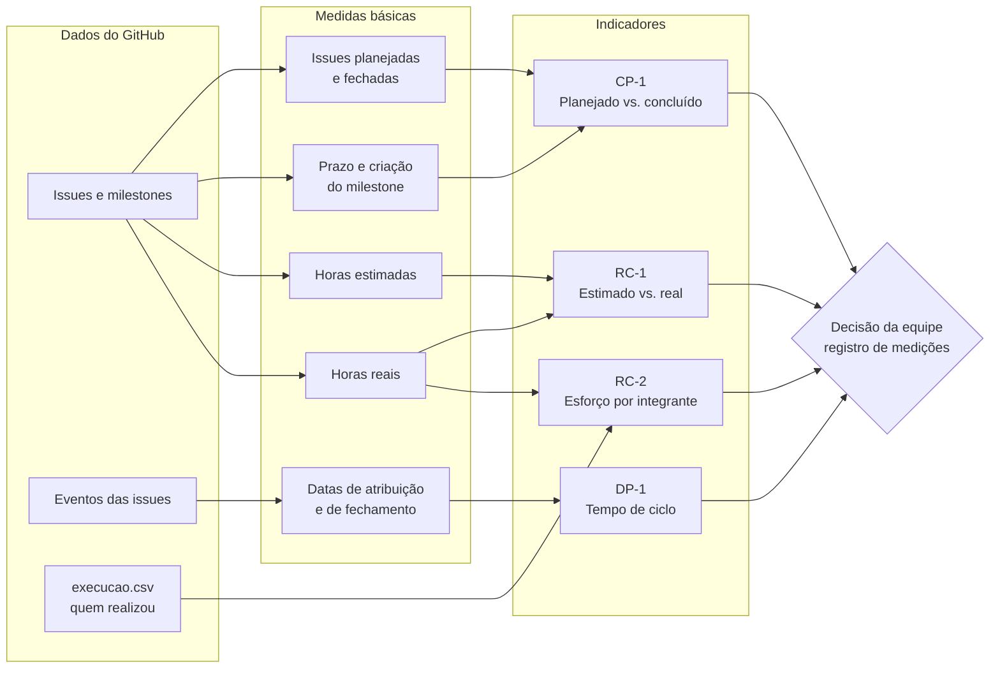
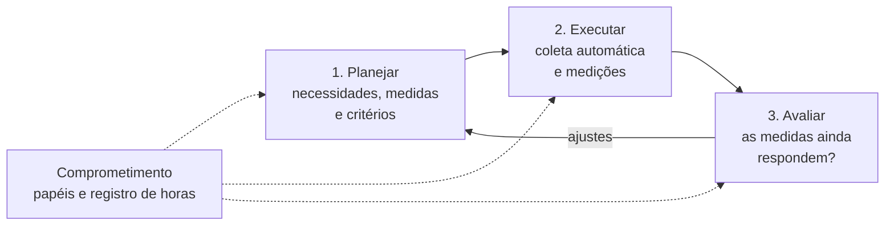

# Gestão do projeto com PSM/CID

Esta página mostra como a equipe mede o próprio trabalho (Premissa 3 e Seção 2 da especificação). As métricas da [Fase 2](../fase-2/index.md) avaliam o produto com GQM; as desta página avaliam a equipe com o PSM (*Practical Software and Systems Measurement*), na versão para desenvolvimento contínuo e iterativo (CID). Cada medida responde a uma necessidade de informação e apoia uma decisão.

[Abrir o painel com os valores atuais](painel.md){ .md-button .md-button--primary } [Ver a contribuição da equipe](../contribuicao.md){ .md-button }

!!! abstract "Propósito da medição"
    **Analisar** o processo de trabalho da equipe Ruth Lichterman **com o propósito de** acompanhar e controlar o andamento das entregas, **com respeito a** progresso, esforço e velocidade do fluxo de trabalho, **do ponto de vista** da equipe e da professora, **no contexto** da disciplina Qualidade de Software 1 (FCTE/UnB, 2026/2, T01), com 6 integrantes, duas entregas e tarefas organizadas em issues e milestones no GitHub. *Modelo de objetivo da Aula 08.*

## Métricas implementadas

A equipe implementou **quatro medidas do guia PSM/CID**, cobrindo as três categorias de informação pedidas na especificação. Clique em um cartão para ver a ficha completa.

<a class="psm-card cat-cp" href="#fichas-do-modelo-de-informacao">
  Calendário e Progresso
  CP-1
  <strong>Planejado vs. concluído</strong>
  <em>Committed vs. Completed</em> · Tabela 5, linha 1 · Parte 2, seção 8.3
  As tarefas da entrega estão no ritmo do prazo?
  Desvio &gt; 5 p.p.: investigar · &gt; 10 p.p.: ação corretiva
  Risco de atraso
</a>
<a class="psm-card cat-rc" href="#fichas-do-modelo-de-informacao">
  Recursos e Custos
  RC-1
  <strong>Horas estimadas vs. reais</strong>
  <em>Estimate vs. Actual Effort</em> · Tabela 5, linhas 8 e 9
  As estimativas de esforço são precisas?
  Razão real ÷ estimado fora de 0,8 a 1,2: rever estimativas
  Falta de informação
</a>
<a class="psm-card cat-rc" href="#fichas-do-modelo-de-informacao">
  Recursos e Custos
  RC-2
  <strong>Esforço por integrante</strong>
  <em>Effort</em> · Tabela 5, linha 7
  O trabalho está distribuído de forma equilibrada?
  Integrante abaixo de 10% ou acima de 30%: analisar a causa
  Problema
</a>
<a class="psm-card cat-dp" href="#fichas-do-modelo-de-informacao">
  Desempenho dos Processos
  DP-1
  <strong>Tempo de ciclo</strong>
  <em>Cycle Time</em> · Tabela 5, linhas 30 e 32 · Parte 2, seção 8.5
  Quanto tempo uma tarefa leva para ficar pronta?
  Issue a mais de 10% da média: investigar · parada há mais de 3 dias: cobrar
  Risco de tarefas paradas
</a>

O guia foi escrito para equipes ágeis que medem *story points*; aqui, a unidade de trabalho é a **issue** e a iteração é o **milestone** de cada entrega. O tipo de questão segue McGarry et al. (2002, cap. 2): problema, risco ou falta de informação.

??? info "Origem de cada medida no guia (tabela)"
    | ID | Categoria de informação | Conceito mensurável | Medida do guia | Origem no guia | Especificação na Parte 2 | Tipo de questão |
    | :--- | :--- | :--- | :--- | :--- | :--- | :--- |
    | CP-1 | Calendário e Progresso (*Schedule and Progress*) | Progresso das unidades de trabalho (*Work Unit Progress*) | *Committed vs. Completed* | Tabela 5, linha 1 | Seção 8.3, com critérios de decisão de 5% e 10% | Risco de atraso na entrega |
    | RC-1 | Recursos e Custos (*Resources and Cost*) | Desempenho financeiro (*Financial Performance*) | *Estimate vs. Actual Effort* e *Estimation Accuracy* | Tabela 5, linhas 8 e 9 | Não há; o cálculo e o critério foram definidos pela equipe | Falta de informação sobre a precisão das estimativas |
    | RC-2 | Recursos e Custos (*Resources and Cost*) | Desempenho financeiro (*Financial Performance*) | *Effort* | Tabela 5, linha 7 | Não há; o cálculo e o critério foram definidos pela equipe | Problema: desequilíbrio de esforço entre integrantes |
    | DP-1 | Desempenho dos Processos (*Process Performance*) | Eficiência do processo: velocidade (*Process Efficiency – Speed*) | *Cycle Time* | Tabela 5, linhas 30 e 32 | Seção 8.5, com critério de decisão de 10% da média | Risco de tarefas paradas |

    *Tabela 1: Origem de cada indicador no PSM/CID. Fonte: PSM/CID Parte 1 (2021), Tabela 5, e Parte 2 (2021), seções 8.3 e 8.5.*

## Como as medidas se ligam

Seguindo McGarry et al. (2002, cap. 2), a equipe padronizou poucas **medidas básicas**, coletadas automaticamente do GitHub, e combinou essas medidas em indicadores diferentes. A Figura 1 mostra o caminho do dado até a decisão.

*Figura 1: Das fontes de dados às decisões. O script [`coleta_psm.py`](https://github.com/FCTE-Qualidade-de-Software-1/2026-2_T01_RUTH_LICHTERMAN/blob/main/scripts/coleta_psm.py) faz a coleta e o cálculo a cada publicação do site, quando uma issue é fechada e a cada 3 horas.*

*Fonte: elaborado pela equipe.*

## Fichas do modelo de informação

Cada medida é descrita no template de instância do modelo de informação da Aula 09 (slide 19), que segue o modelo de McGarry et al. (2002, cap. 2). Escolha o indicador na aba.

=== "CP-1 · Planejado vs. concluído"

    | Campo do template | Definição |
    | :--- | :--- |
    | Necessidade de informação | As tarefas planejadas para a entrega estão sendo concluídas no ritmo do prazo? Quais estão em risco? |
    | Conceito mensurável | Progresso das unidades de trabalho |
    | Entidades relevantes | Issues do milestone da entrega |
    | Atributos | Situação da issue (aberta ou fechada); datas de criação e de prazo do milestone |
    | Medidas básicas | 1. P = issues planejadas no milestone. 2. C = issues fechadas no milestone. 3. Fração do prazo do milestone já decorrida |
    | Método de medição | 1 e 2. Contagem automática das issues pela API do GitHub. 3. (agora − criação do milestone) ÷ (prazo − criação do milestone) |
    | Tipo de método de medição | 1, 2 e 3. Objetivo |
    | Escala | 1 e 2. Inteiros de zero ao infinito. 3. Reais de 0 a 1 |
    | Tipo de escala | 1, 2 e 3. Razão |
    | Unidade de medida | 1 e 2. Issue. 3. Adimensional |
    | Medidas derivadas | Percentual concluído; progresso esperado; desvio |
    | Função de medição | Concluído (%) = C × 100 ÷ P. Esperado (%) = fração decorrida × 100. Desvio (p.p.) = esperado − concluído |
    | Indicador | Gráfico de progresso por milestone e Tabela 2 do [Painel PSM](painel.md) |
    | Modelo de análise | Quanto maior o desvio, maior o risco de a entrega não ficar pronta no prazo. Um desvio alto com muitas tarefas já feitas indica registro atrasado nas issues, e não trabalho atrasado. Só conta como concluída a issue fechada, que deve atender ao seu critério de pronto, como recomendam McGarry et al. (2002, cap. 2, exemplo de progresso) |
    | Critérios de decisão | **Guia (Parte 2, seção 8.3):** diferença entre o planejado e o concluído acima de 5%, investigar as causas; acima de 10%, tomar ação corretiva. **Adaptação da equipe:** o guia compara no fim da iteração; aqui a comparação é feita durante o milestone, contra o progresso esperado para a data |

=== "RC-1 · Estimado vs. real"

    | Campo do template | Definição |
    | :--- | :--- |
    | Necessidade de informação | As estimativas de esforço da equipe são precisas? Em que tipo de tarefa a equipe mais erra a estimativa? |
    | Conceito mensurável | Desempenho financeiro |
    | Entidades relevantes | Issues fechadas com horas estimadas e horas reais preenchidas |
    | Atributos | Esforço estimado e esforço realizado |
    | Medidas básicas | 1. E = soma das horas estimadas. 2. R = soma das horas reais |
    | Método de medição | 1. Leitura do campo *Horas estimadas*, preenchido na criação da issue. A partir da E2, a estimativa é feita por *Planning Poker* (Cohn, 2005): cada integrante escolhe uma carta de 0,5, 1, 2, 3, 5 ou 8 horas, usando como referência tarefas já concluídas de tamanho parecido, e a equipe discute até chegar a um consenso. 2. Leitura do campo *Horas reais*, preenchido pelo responsável ao fechar |
    | Tipo de método de medição | 1. Subjetivo (a estimativa é um julgamento). 2. Objetivo (registro do tempo gasto). A leitura dos campos é automática |
    | Escala | 1 e 2. Reais de zero ao infinito |
    | Tipo de escala | 1 e 2. Razão |
    | Unidade de medida | 1 e 2. Hora |
    | Medida derivada | Razão de esforço |
    | Função de medição | Razão = R ÷ E |
    | Indicador | Razão geral (Tabela 1), gráfico e tabela de horas estimadas vs. reais por integrante e comparação por issue no [Painel PSM](painel.md). Por integrante, o estimado é o das tarefas que a pessoa recebeu e o real é o das tarefas que ela de fato executou |
    | Modelo de análise | Razão acima de 1: a equipe subestimou o esforço; abaixo de 1: superestimou |
    | Critérios de decisão | **Equipe:** razão fora da faixa de 0,8 a 1,2, revisar as estimativas das issues restantes do mesmo tipo |

=== "RC-2 · Esforço por integrante"

    | Campo do template | Definição |
    | :--- | :--- |
    | Necessidade de informação | Quanto esforço cada integrante dedicou ao projeto? O trabalho está distribuído de forma equilibrada? |
    | Conceito mensurável | Desempenho financeiro (esforço) |
    | Entidades relevantes | Issues fechadas e integrantes da equipe |
    | Atributos | Horas reais e responsáveis de cada issue |
    | Medidas básicas | 1. Hᵢ = horas reais do integrante i. 2. H = horas reais da equipe |
    | Método de medição | 1. Soma das horas reais das issues fechadas que o integrante realizou. Quem realizou vem do arquivo [execucao.csv](dados/execucao.csv), preenchido pela equipe; sem registro, vale o responsável da issue. Com mais de uma pessoa, as horas são divididas igualmente. 2. Soma de todas as horas reais |
    | Tipo de método de medição | 1 e 2. Objetivo (registro do tempo gasto); o cálculo é automático |
    | Escala | 1 e 2. Reais de zero ao infinito |
    | Tipo de escala | 1 e 2. Razão |
    | Unidade de medida | 1 e 2. Hora-pessoa |
    | Medida derivada | Percentual de esforço do integrante |
    | Função de medição | Esforço (%) = Hᵢ × 100 ÷ H |
    | Indicador | Gráfico de esforço por integrante no [Painel PSM](painel.md); tabela por entrega e quadro "alocado vs. realizado" na página [Contribuição da Equipe](../contribuicao.md) |
    | Modelo de análise | Percentual muito acima da média indica sobrecarga; muito abaixo indica pouca participação ou trabalho não registrado |
    | Critérios de decisão | **Equipe:** integrante abaixo de 10% ou acima de 30% sinaliza desequilíbrio. A equipe analisa a causa e decide se rebalanceia as próximas atribuições, registrando a justificativa no registro de decisões. As horas reais já registradas não são alteradas |

=== "DP-1 · Tempo de ciclo"

    | Campo do template | Definição |
    | :--- | :--- |
    | Necessidade de informação | Quanto tempo uma tarefa leva desde que alguém a assume até ficar pronta? Há tarefas paradas? |
    | Conceito mensurável | Eficiência do processo: velocidade |
    | Entidades relevantes | Issues atribuídas, exceto as retroativas (criadas já concluídas) |
    | Atributos | Data da primeira atribuição e data de fechamento |
    | Medidas básicas | 1. Data de início: primeira atribuição de responsável. 2. Data de fim: fechamento da issue |
    | Método de medição | 1. Leitura do evento *assigned* no histórico da issue. 2. Leitura da data de fechamento, ambas pela API do GitHub |
    | Tipo de método de medição | 1 e 2. Objetivo |
    | Escala | 1 e 2. Datas do calendário |
    | Tipo de escala | 1 e 2. Intervalar |
    | Unidade de medida | 1 e 2. Dia |
    | Medidas derivadas | Tempo de ciclo de cada issue; média de tempo de ciclo; idade das issues abertas com responsável |
    | Função de medição | Tempo de ciclo = (data de fim − data de início) + 1, em dias, como no guia (Parte 2, seção 8.5). Idade = (hoje − data de início) + 1 |
    | Indicador | Tabela 5 e lista de issues paradas no [Painel PSM](painel.md) |
    | Modelo de análise | Tempos maiores indicam tarefas grandes demais ou paradas; a comparação entre medições mostra se o fluxo está ficando mais previsível |
    | Critérios de decisão | **Guia (Parte 2, seção 8.5):** investigar qualquer issue com tempo de ciclo a mais de 10% da média. Como a unidade é o dia inteiro, a tolerância mínima é de 1 dia. **Equipe:** issue do milestone ativo com responsável há mais de 3 dias sem fechar, cobrar o responsável ou dividir a tarefa (critério revisto na Medição 2) |

*Tabela 2: Instâncias do modelo de informação. Os critérios marcados como "Equipe" foram definidos pelo grupo e podem ser revistos a cada medição. Fonte: elaborado pela equipe, com base na Aula 09 e no PSM/CID.*

## Processo de medição

O PSM organiza a medição em quatro atividades que se repetem a cada ciclo (McGarry et al., 2002, cap. 1).

*Figura 2: Ciclo de medição do PSM aplicado ao projeto.*

*Fonte: elaborado pela equipe, com base em McGarry et al. (2002).*

??? info "O que a equipe faz em cada atividade"
    | Atividade | Como a equipe faz |
    | :--- | :--- |
    | Planejar a medição | Necessidades de informação, escolha das medidas no guia e fichas desta página |
    | Executar a medição | Coleta automática pelo script, medições registradas e decisões na Tabela 9 |
    | Avaliar a medição | A cada medição, a equipe revê se as medidas respondem às necessidades. Até agora: a taxa de retrabalho foi trocada pelo tempo de ciclo, por não estar no guia; o critério de issue parada passou a valer só para o milestone ativo (Medição 2); e as horas reais de 15 issues foram registradas iguais à estimativa, o que reduz a confiança no RC-1 da E1. Na E2, cada pessoa registra as horas ao fechar a própria issue |
    | Manter o comprometimento | Hauedy e Letícia mantêm o script, o painel e as medições; cada integrante registra as horas reais e quem realizou cada tarefa; as decisões são discutidas no grupo da equipe |

## Medições e decisões

  
<strong>Medição 1</strong>26/10, 00h10<em>Início do dia da E1</em>

  
<strong>Medição 2</strong>26/10, 00h48<em>Efeito das decisões da Medição 1</em>

  
<strong>Medição 3</strong>A definir<em>Metade do prazo da E2</em>

  
<strong>Medição 4</strong>A definir<em>Véspera da E2</em>

Efeito das decisões da Medição 1, medido na Medição 2:

  
CP-1 · desvio do esperado<strong>51,5 → 17,0 p.p.</strong><em class="up">melhorou</em>

  
RC-1 · real ÷ estimado<strong>1,24 → 1,12</strong><em class="up">entrou na faixa</em>

  
RC-2 · maior participação<strong>35% → 24%</strong><em class="up">menos concentrada</em>

  
DP-1 · tempo médio de ciclo<strong>1,6 → 2,0 dias</strong><em class="flat">mais issues medidas</em>

=== "Medição 1 (26/10, 00h10)"

    | Indicador | Valor | Interpretação | Decisão, responsável e prazo |
    | :--- | :--- | :--- | :--- |
    | **CP-1** Ação corretiva | 15 de 43 issues da E1 concluídas (34,9%); esperado 86,4%; desvio de 51,5 p.p. | A maior parte das issues abertas já foi feita no artigo e no site (por exemplo, #10, #17 a #19, #21 a #24, #26, #29, #30 e #33 a #36), mas não foi fechada porque as horas reais não foram informadas. O desvio mede, sobretudo, registro atrasado. Continuam pendentes de fato #27, #28, #32, #37, #41 e #42 | Cada responsável informa as horas reais das issues concluídas, e Hauedy as fecha com o script `scripts/atribuir_issues.ps1`. Responsáveis: todos. Prazo: 26/10 |
    | **RC-1** Fora da faixa | 1,24 (24,6 h reais ÷ 19,8 h estimadas, 16 issues) | A equipe subestimou tarefas de apresentação e de redação: #9 (3 h estimadas, 5 h reais), #20 (2 h e 4 h) e #8 (1 h e 2 h) | Nas issues de redação e de apresentação da E2, estimar com margem de 25%. Responsável: quem cria a issue. Prazo: criação das issues da E2 |
    | **RC-2** Fora da faixa | Arthur 35%, Lucas 25%, Giovana 22%, Daniel 9%, Hauedy 8%, Letícia 1% | Arthur concentrou as primeiras tarefas. O trabalho de repositório e GitPage de Hauedy e Letícia ainda não tinha issue com horas registradas | Em 25/10, as issues abertas foram atribuídas para equilibrar o esforço previsto, sem novas issues para Arthur (previsão na página [Contribuição da Equipe](../contribuicao.md)). Hauedy e Letícia abrem issues com as horas reais do trabalho ainda não registrado. Prazo: 26/10 |
    | **DP-1** Investigar e alerta | Média de 1,6 dia (7 issues); #20 e #57 com 3 dias; 7 issues com responsável desde 23/10 (#10, #26, #28, #48, #49, #51 e #52) | #20 e #57 foram tarefas grandes (todas as métricas e a padronização da norma). Entre as paradas, #10 e #26 já estão feitas, #28 é a revisão final, prevista para o dia da entrega, e #48 a #52 são da E2 | Fechar #10 e #26 junto com a decisão do CP-1. Na E2, dividir tarefas grandes em issues menores. Responsável: Hauedy. Prazo: criação das issues da E2 |

=== "Medição 2 (26/10, 00h48)"

    | Indicador | Valor | Interpretação | Decisão, responsável e prazo |
    | :--- | :--- | :--- | :--- |
    | **CP-1** Ação corretiva | 30 de 43 issues da E1 concluídas (69,8%); esperado 86,8%; desvio de 17,0 p.p. | A decisão da Medição 1 reduziu o desvio de 51,5 para 17,0 p.p. Das 13 issues abertas, #38 a #41 foram concluídas nesta noite e ainda não fechadas; #12, #13, #14 e #16 dependem de confirmação dos responsáveis; #27, #28, #32, #37 e #42 estão pendentes | Fechar #38 a #41 com as horas reais (Hauedy). Responsáveis por #12, #13, #14 e #16 confirmam se o conteúdo já está no artigo. Giovana conclui #27 e #28, Letícia conclui #32 e #42, e Hauedy faz a release (#37) por último. Prazo: envio da E1 |
    | **RC-1** Dentro da faixa | 1,12 (45,5 h reais ÷ 40,8 h estimadas, 31 issues) | A razão entrou na faixa porque as 15 issues fechadas após a Medição 1 tiveram as horas reais registradas iguais à estimativa, por decisão da equipe. A subestimação observada na Medição 1 continua valendo para as tarefas de redação e de apresentação | Manter a margem de 25% decidida na Medição 1. Quem gastou um tempo diferente do estimado corrige o campo *Horas reais* da issue. Prazo: E2 |
    | **RC-2** Fora da faixa | Lucas 24%, Giovana 23%, Daniel 21%, Arthur 19%, Hauedy 8%, Letícia 5% | O rebalanceamento resolveu a sobrecarga de Arthur e a baixa participação de Daniel. Hauedy e Letícia continuam abaixo de 10% porque #38 a #41 e o trabalho de repositório ainda não têm horas reais registradas | Fechar #38 a #41 e abrir issues com as horas reais do trabalho de repositório e GitPage ainda não registrado. Responsáveis: Hauedy e Letícia. Prazo: 26/10 |
    | **DP-1** Investigar e alerta | Média de 2,0 dias (22 issues); #10 e #26 com 4 dias; 5 issues com responsável há mais de 3 dias (#28, #48, #49, #51 e #52) | #10 e #26 já estavam feitas e só foram fechadas agora, então o tempo de ciclo delas mede o atraso de registro. #28 está prevista para o dia da entrega. #48 a #52 são da E2, que ainda não começou | Revisão do critério da equipe: a partir desta medição, só contam como paradas as issues do milestone ativo. Fechar cada issue no mesmo dia em que for concluída. Responsáveis: todos. Prazo: E2 |

*Tabela 3: Registro das medições, interpretações e decisões de gestão. Fonte: [medicoes.csv](dados/medicoes.csv) e decisões da equipe.*

!!! note "Decisões de planejamento da E2 (26/10)"
    1. **Reestimativa por Planning Poker.** Seguindo a decisão do RC-1 na Medição 1, as issues abertas foram reestimadas com as cartas de 0,5 a 8 horas, tendo as tarefas concluídas como referência. O total estimado passou de 38 h para 48,5 h, principalmente em coleta e análise da Fase 4, ação de melhoria e versão final do artigo. As estimativas das issues já fechadas não foram alteradas, para não comprometer a comparação entre estimado e real.
    2. **Atribuição conforme a participação.** As tarefas da E2 foram distribuídas considerando a participação de cada integrante até aqui. Quem mais contribuiu na E1 recebe as tarefas de maior peso, e a carga prevista de Letícia fica abaixo da faixa do RC-2. Por isso, o RC-2 continua sendo acompanhado a cada medição, sem rebalanceamento automático. A previsão por integrante está na página [Contribuição da Equipe](../contribuicao.md).
    3. **Registro de quem realizou cada tarefa.** Quando quem fez a tarefa não é quem estava alocado, isso é registrado em [execucao.csv](dados/execucao.csv), e as horas reais passam a contar para quem realizou.

---

### Histórico de versão

### Histórico de versão

| Versão | Data | Descrição | Autor(a) | Revisor(a) |
| :--- | :--- | :--- | :--- | :--- |
| 1.0 | 19/10/2026 | Criação da página com indicadores e procedimento de medição | [Hauedy Wegner](https://github.com/HauedyWS) | [Letícia Lopes](https://github.com/leticialopes20) |
| 1.1 | 26/10/2026 | Indicadores ligados à Tabela 5 do PSM/CID, fichas no template da Aula 09, troca da taxa de retrabalho pelo tempo de ciclo e registro da Medição 1 | [Hauedy Wegner](https://github.com/HauedyWS) | [Letícia Lopes](https://github.com/leticialopes20) |
| 1.2 | 26/10/2026 | Registro da Medição 2 e revisão do critério de issues paradas | [Hauedy Wegner](https://github.com/HauedyWS) | [Letícia Lopes](https://github.com/leticialopes20) |
| 1.3 | 26/10/2026 | Métricas implementadas, horas estimadas vs. reais, alocado vs. realizado e processo de medição (McGarry et al., 2002) | [Hauedy Wegner](https://github.com/HauedyWS) | [Letícia Lopes](https://github.com/leticialopes20) |
| 1.4 | 26/10/2026 | Planning Poker nas estimativas e decisões de planejamento da E2 | [Hauedy Wegner](https://github.com/HauedyWS) | [Letícia Lopes](https://github.com/leticialopes20) |
| 1.5 | 26/10/2026 | Página reorganizada de forma visual: visão geral em cartões, diagramas, fichas em abas e medições por aba | [Hauedy Wegner](https://github.com/HauedyWS) | [Letícia Lopes](https://github.com/leticialopes20) |
