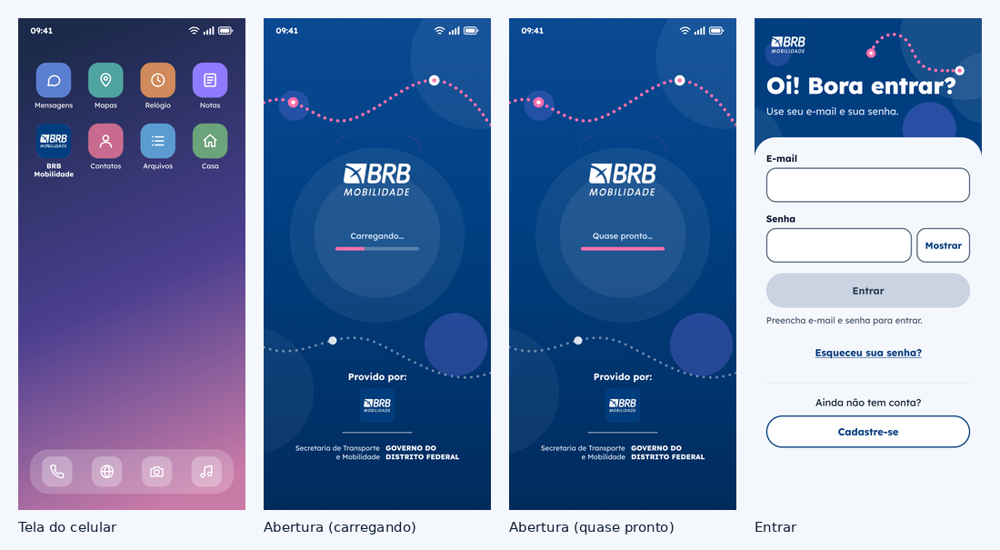
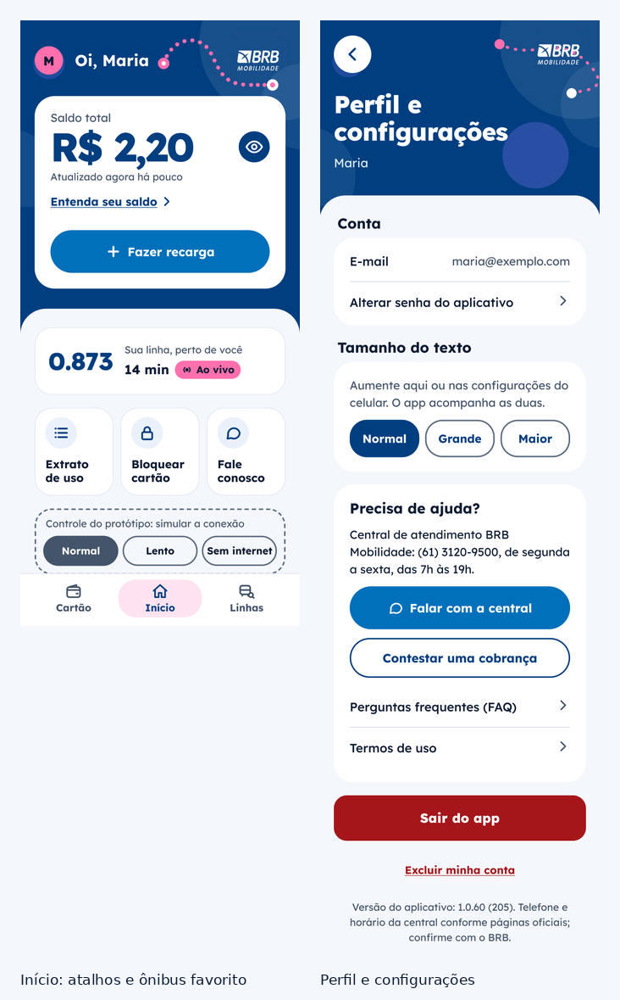
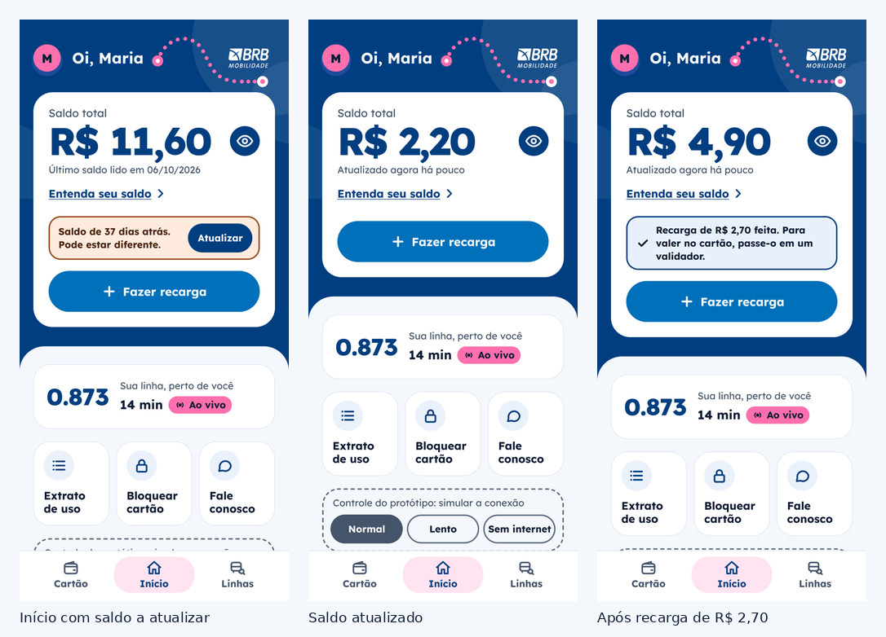
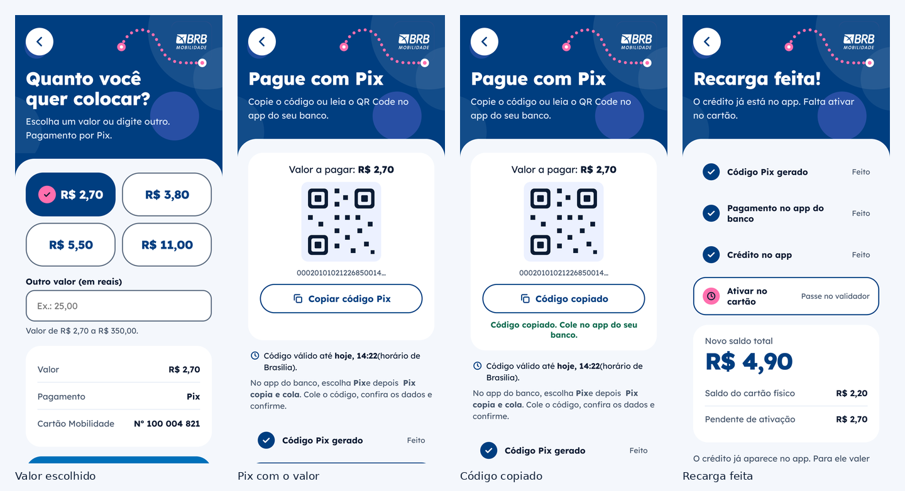
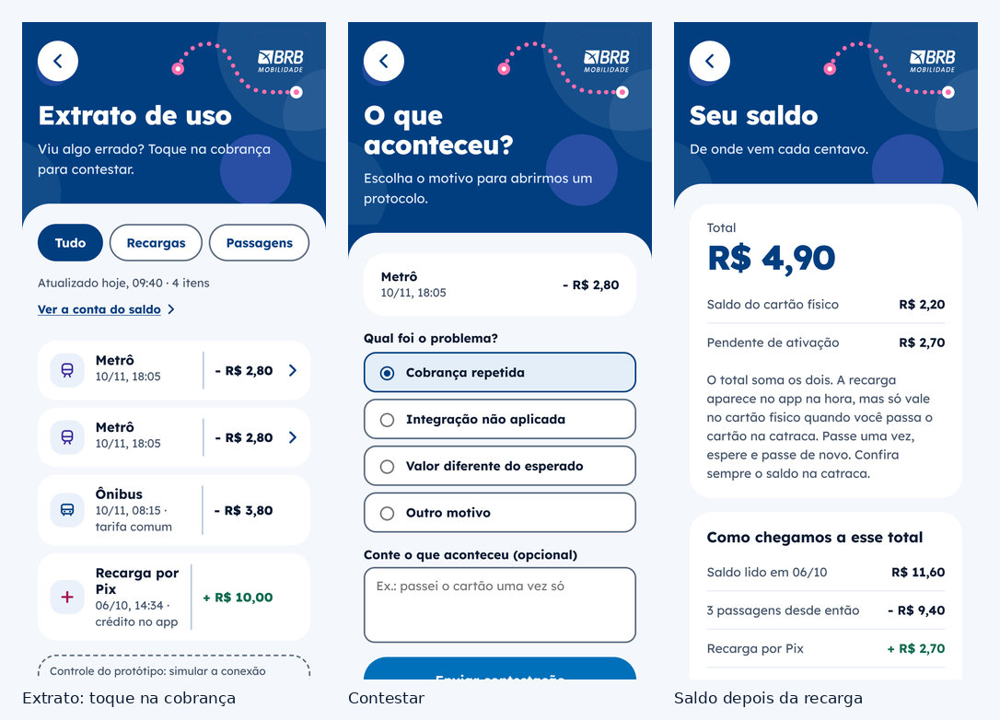
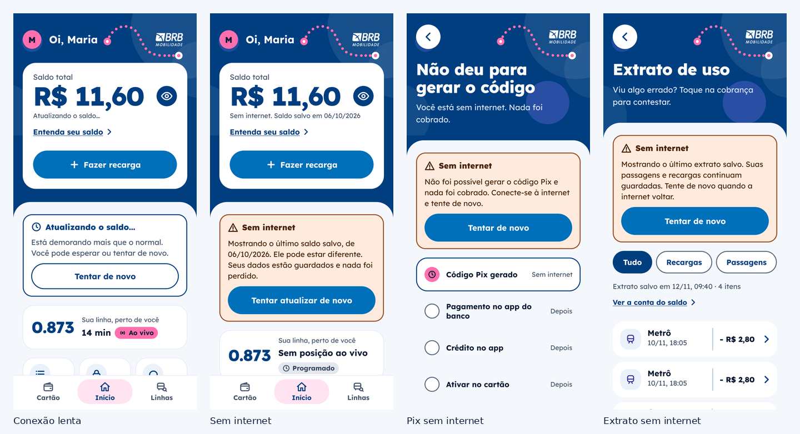
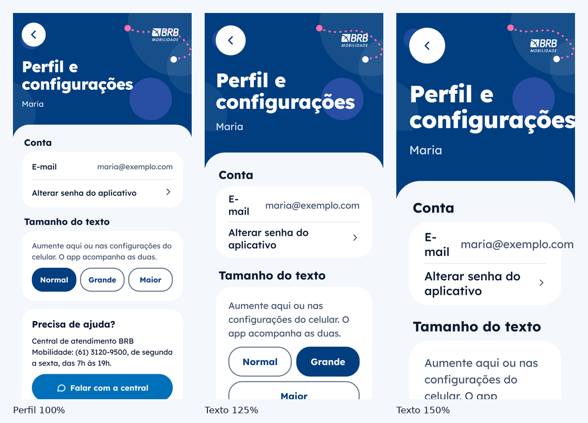
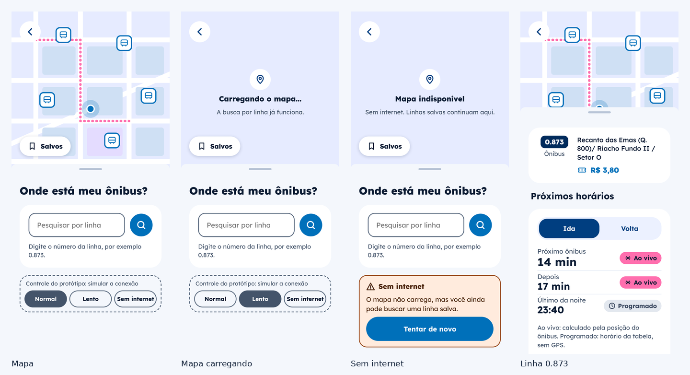

# Protótipo — versão 2

Equipe Ruth Lichterman. A v2 evolui o [protótipo de A1 e A2 (v1)](v1.md), concluído em 15/11/2026, que **permanece sem alteração**. Esta página registra, de 24/11/2026, o que mudou da v1 para a v2: o visual, os botões, os fluxos e os estados de conexão.

**[Abrir o protótipo navegável da v2](https://www.figma.com/proto/cKG7Stdd8v0K7UFOhxd02t/BRB-MOBILIDADE--PROTOTIPA%C3%87%C3%83O--Copy-?node-id=3174-357&p=f&scaling=scale-down&content-scaling=fixed&starting-point-node-id=3174%3A357)** 

As telas usam dados fictícios. As imagens desta página foram exportadas do Figma.

## Resumo do que mudou

| Aspecto | v1 | v2 |
| :--- | :--- | :--- |
| Escopo | Percursos de A1 e A2: consulta e recarga interrompidas, reabertura, retorno após bloqueio, fonte de 100% e 200% | Aplicativo de ponta a ponta: celular e abertura, entrada, início, cartão, recarga, Pix, saldo, extrato, contestação, bloqueio, linhas, mapa, busca, grade horária, linhas salvas e perfil (81 telas) |
| Visual | Telas reconstruídas a partir das referências do aplicativo | Identidade própria, com cabeçalho azul, trilha pontilhada rosa, cartões brancos arredondados e a logo do BRB em posições fixas ([detalhes](#visual)) |
| Tela inicial e perfil | Telas de A1 e A2, sem reorganização do início nem do perfil | Início com as opções mais importantes à mostra e o ônibus favorito em tempo real; perfil com poucas opções ([detalhes](#tela-inicial-e-perfil)) |
| Botões | Botões das telas de A1 e A2 | Botões largos e cartões inteiros clicáveis, com tipos de botão definidos ([detalhes](#botoes-e-areas-de-toque)) |
| Fluxos | Percursos de demonstração, com pontos de partida C1–C4 | Fluxos encadeados, em que o valor escolhido na recarga segue até o Início e o Saldo ([detalhes](#fluxos)) |
| Fonte | Início, extrato, valor da recarga e Pix em 100% e 200% | Perfil em 125% e 150%. A ampliação de 200% da v1 continua sendo a referência de A2 |

## Visual

O visual da v2 foi revisto para ficar mais próximo do aplicativo e mais consistente entre as telas:

- **Cores:** azul-marinho (#003E80) e azul (#0070BA) como base, rosa (#FF6FAE) como destaque e um fundo claro (#F4F7FC). A fonte é a Lexend, em telas de 390 × 844 px.
- **Trilha pontilhada:** uma rota rosa com pontos acompanha o cabeçalho das telas e a abertura, como elemento de marca. Os pontos seguem a linha da trilha e ela não passa sobre a logo.
- **Logo do BRB:** foi colocada em tamanho maior no cabeçalho das telas.
- **Cabeçalho e cartões:** título grande sobre fundo azul e conteúdo em cartões brancos arredondados, com informação em blocos curtos.
- **Telas de entrada:** a abertura e a tela de entrada aproveitam melhor o espaço, sem textos encostados no rodapé, e o visual da tela de carregamento foi alterado.

*Figura 1: Tela do celular, abertura (carregando e quase pronto) e entrada da v2. Fonte: elaborado pela equipe.*

**Contraste.** As combinações principais da paleta, calculadas pela razão de luminância relativa (a mesma fórmula da [verificação da v1](v1-verificacao.md#contraste-do-botao-principal)), ficam acima do mínimo de 4,5:1 para texto comum: texto branco sobre o botão azul (#0070BA), 5,22:1; branco sobre azul-marinho, 10,5:1; texto principal (#0B1B33) sobre branco, 17,2:1; texto secundário (#44546A) sobre branco, 7,7:1. É um cálculo das cores do projeto, não uma medição do aplicativo.

## Tela inicial e perfil

A tela inicial foi reorganizada para que o mais usado fique à vista, sem precisar abrir menus:

- **Opções principais no Início:** **Extrato de uso**, **Bloquear cartão** e **Fale conosco** ficam em três atalhos logo abaixo do saldo, em vez de escondidos em menus.
- **Ônibus favorito em tempo real:** o cartão "Sua linha, perto de você" mostra a linha favoritada (a 0.873 no protótipo) e **em quantos minutos ela passa**, com a marca "Ao vivo". Quando não há posição em tempo real, o cartão avisa e passa a mostrar o horário programado.
- **Perfil enxuto:** o perfil teve **muitas opções retiradas**. Restaram a conta (e-mail e alteração da senha), o tamanho do texto (Normal, Grande e Maior), a ajuda (Falar com a central, Contestar uma cobrança, perguntas frequentes e termos de uso) e as ações de sair do app e excluir a conta. O que era usado com mais frequência subiu para o Início.

*Figura 2: Tela inicial com os atalhos de Extrato de uso, Bloquear cartão e Fale conosco e o ônibus favorito em tempo real, e o Perfil e configurações. Fonte: elaborado pela equipe.*

## Botões e áreas de toque

- **Tipos de botão:** principal (preenchido em azul), secundário (contorno), de destaque (rosa), de perigo (vermelho, no bloqueio) e desabilitado (cinza, até o campo ser preenchido ou a caixa marcada).
- **Tamanho:** os botões ocupam a largura do cartão e têm altura mínima de cerca de 50 px no quadro de 390 px. Não houve medição de área de toque em aparelho.
- **Navegação:** botão de voltar circular no cabeçalho, menu de baixo (Cartão, Início e Linhas) fixo nas telas principais e olho do saldo para ocultar e mostrar o valor.

## Fluxos

Como o Figma não guarda estado, cada situação do aplicativo é uma tela, e as ligações entre elas foram refeitas para que o fluxo se mantenha coerente. A recarga é o caso principal:

1. No **Início**, com o saldo lido há muito tempo, o botão "Atualizar" leva ao Início com o saldo atualizado.
2. Em **Fazer recarga**, o usuário escolhe o cartão (o próprio ou o de outra pessoa) e o valor (R$ 2,70, R$ 3,80, R$ 5,50, R$ 11,00 ou outro).
3. No **Pix**, a tela mostra o valor escolhido. Ao copiar o código, o pagamento é confirmado após alguns segundos.
4. Em **Recarga feita**, o saldo novo aparece com a composição: saldo do cartão físico e valor pendente de ativação. "Voltar ao início" mostra o **Início atualizado**, com o saldo novo e o aviso de que a recarga passa a valer no cartão ao passá-lo em um validador.
5. **Entenda seu saldo** mostra a composição do total depois da recarga.
6. Se a recarga for para **outra pessoa**, o Pix mostra o cartão dela e o pagamento não altera o saldo do cartão da usuária.

*Figura 3: Início da v2, com o saldo a atualizar, o saldo atualizado e o Início após uma recarga de R$ 2,70. Fonte: elaborado pela equipe.*

*Figura 4: Fluxo da recarga com o valor escolhido (R$ 2,70) mantido do início ao fim. Fonte: elaborado pela equipe.*

**Extrato e contestação.** No extrato, o aplicativo não aponta cobrança repetida por conta própria: a pessoa confere a lista e toca na cobrança que quer contestar, o que abre a tela de contestação, com os motivos e o envio. As telas de saldo também deixaram de trazer avisos de erro automáticos.

*Figura 5: Extrato com a cobrança tocável, tela de contestação e saldo depois da recarga. Fonte: elaborado pela equipe.*

O **bloqueio do cartão** exige marcar a confirmação antes de habilitar o botão. As telas de **linhas** reúnem o mapa, a busca, a linha com os horários, a grade horária e as linhas salvas.

## Estados de conexão

Em Início, Pix, Extrato, Mapa e Linha, os botões **Normal**, **Lento** e **Sem internet** mostram cada situação. Os estados informam o problema, dizem o que foi preservado ("nada foi cobrado", "seus dados estão guardados") e oferecem **Tentar de novo**. No Pix há também o caso em que a conexão cai depois de o código ser gerado. A lista de fluxos do Figma traz ainda a tela "Simular conexão", que reúne todas as opções.

*Figura 6: Início com conexão lenta e sem internet, Pix sem internet e Extrato sem internet. Fonte: elaborado pela equipe.*

Os controles de conexão são recursos da demonstração; o aplicativo real deve detectar a conexão sozinho. Os estados representam o comportamento, sem medir tempo no aplicativo.

## Fonte ampliada

A tela de Perfil existe em texto de 100%, 125% e 150%, com quebra de linha e rolagem.

*Figura 7: Perfil da v2 com texto em 100%, 125% e 150%. Fonte: elaborado pela equipe.*

## Linhas e mapa

A aba **Linhas** abre o mapa com as paradas próximas e a busca por linha ("Onde está meu ônibus?"). Ao escolher a linha, a tela mostra o trajeto, os próximos horários de ida e volta e a diferença entre horário **ao vivo** (calculado pela posição do ônibus) e **programado** (da tabela, sem GPS). Com conexão lenta o mapa mostra "Carregando o mapa…" e, sem internet, "Mapa indisponível", avisando que a busca por linha e as linhas salvas continuam funcionando.

*Figura 8: Mapa, estado de carregamento, mapa sem internet e a linha 0.873 com os próximos horários. Fonte: elaborado pela equipe.*

## Rastreabilidade com a avaliação

| Achado de origem | Mudança na v2 | Onde ver |
| :--- | :--- | :--- |
| M13 / RF01: o aplicativo continuou carregando, sem aviso de perda de conexão ([registro](https://github.com/FCTE-Qualidade-de-Software-1/2026-2_T01_RUTH_LICHTERMAN/blob/main/evidencias/gqm/registro_dos_testes.md)) | Estados lenta e sem internet com mensagem e "Tentar de novo" em Início, Pix, Extrato, Mapa e Linha; no Pix, também a conexão que cai depois do código | [Estados de conexão](#estados-de-conexao) |
| M11: abertura do mapa e das paradas em cerca de 5,3 s | Estado de carregamento do Mapa e da Linha. Não mede nem reduz o tempo real (A3 continua como proposta futura) | Mapa e Linha em "Lento" |
| M4 / AC01: a fonte não acompanhou a ampliação do sistema | aplicativo com fonte dos textos de 125% 150% e 200% | [Fonte ampliada](#fonte-ampliada) |
| M9 e M10 / RR01: total de R$ 13,40 com saldo físico e crédito pendente; atualização no aplicativo em 1 s | Tela "Entenda seu saldo", composição do total e aviso de que a recarga vale no cartão ao passar no validador | [Fluxos](#fluxos) |

## Refinamentos que não vêm da avaliação

Além das mudanças que respondem aos achados da avaliação GQM, a equipe propôs melhorias para o próprio aplicativo ao analisar o que ele oferece. Elas foram implementadas na v2 e ficam registradas à parte para não serem atribuídas aos testes:
 
| Melhoria no aplicativo | Motivo |
| :--- | :--- |
| Atalhos de **Extrato de uso**, **Bloquear cartão** e **Fale conosco** na tela inicial | Reduzir os passos para as ações mais usadas, que antes ficavam em menus |
| **Ônibus favorito em tempo real** no Início, com os minutos até a chegada e a marca "Ao vivo" | Mostrar quando o ônibus passa sem precisar abrir o mapa |
| **Perfil com poucas opções**: conta, tamanho do texto, ajuda e sair | Deixar no perfil só o essencial, já que o mais usado subiu para o Início |
| **Extrato sem aviso automático de cobrança repetida**; a pessoa confere a lista e toca na cobrança para contestar | O aplicativo não deveria apontar o problema por conta própria |
 
Os ajustes do próprio protótipo (logo, trilha pontilhada, ligações entre as telas, valor da recarga mantido e controles de conexão) estão nas seções [Visual](#visual), [Fluxos](#fluxos) e [Estados de conexão](#estados-de-conexao).

## Alcance e limites

O Figma simula estados e navegação; não detecta a rede do aparelho, não processa pagamentos e não implementa persistência nem prevenção de duplicidade. Como não guarda estado entre telas, voltar ao Início pela aba do menu, depois de sair para outra aba, mostra o Início sem o aviso da recarga.

A conferência da v2 foi feita pela equipe, com a verificação automática das ligações do protótipo (81 telas reconhecidas e nenhum destino inválido) e a navegação manual. Não houve nova coleta GQM nem validação com participantes. **Os resultados originais de M4, M9, M10, M11 e M13 permanecem inalterados**, e a v2 não atribui novos percentuais ou níveis a essas métricas. O reteste da v2 com participantes fica como trabalho futuro.

### Histórico de Versão

| Versão | Data | Descrição | Autor | Revisor |
| :--- | :--- | :--- | :--- | :--- |
| 1.0 | 24/11/2026 | Registro da v2 do protótipo: visual, botões, fluxos, estados de conexão e rastreabilidade | [Letícia Lopes](https://github.com/leticialopes20) | [Lucas Branco](https://github.com/lucasbbranco)|
